# AnimateCar3D

Fast 3D animation of scenes with many vehicles in MATLAB: decision branches, surrounding traffic, pedestrians, and moving items, with no extra toolboxes or immersive simulators (CARLA, RoadRunner, Simscape, etc.).

AnimateCar3D builds on [CarMesh3D](https://github.com/ivsg-psu/VehicleSimulations_VehiclePlotting_CarMesh3D), which makes, views, and checks the mesh of one vehicle at a time. AnimateCar3D uses CarMesh3D's vehicle meshes and plotting functions, and adds everything needed for many objects in one scene.

> **Status:** prototype (2026_11_20). Steps 0 to 6 of the [Development plan](#development-plan) are done: scenes are read from a scene list and motion files (or from a folder of live data), kept in an object catalog, and drawn through the selector and the scene player; pedestrians and moving items are drawn as simple shapes; and each object's detail is set by its [size on screen](#detail-levels-set-by-size-on-screen-step-5), from a ladder of reduced meshes made by CarMesh3D (release `CarMesh3D_2026_11_20`); and path lines show where objects have been and will go. Next: see the [TO-DO](#to-do) list.

| One vehicle splitting into ten decision branches | A confederate's three maneuvers, and the ego's three responses |
|---|---|
| 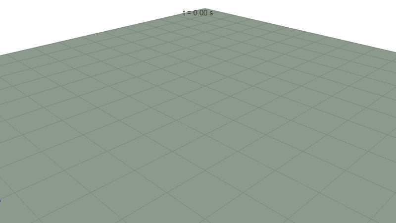 | 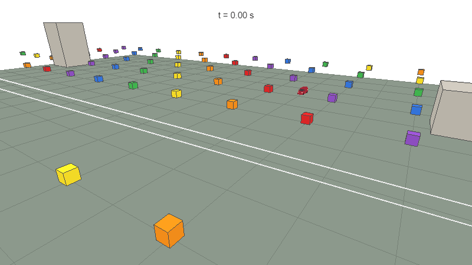 |

| 300 vehicles from one traffic file, with a panning camera | 1000 vehicles: the far ones merged, each at its detail level |
|---|---|
| 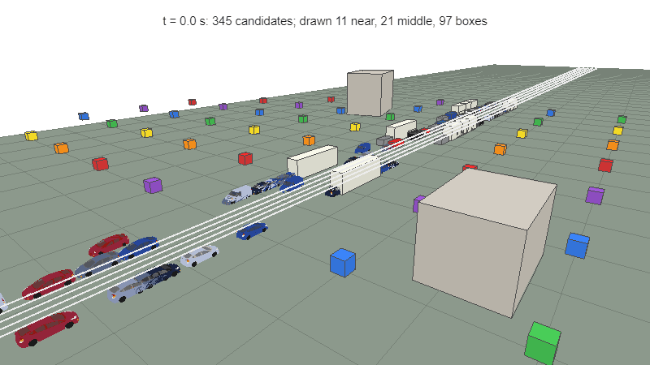 | 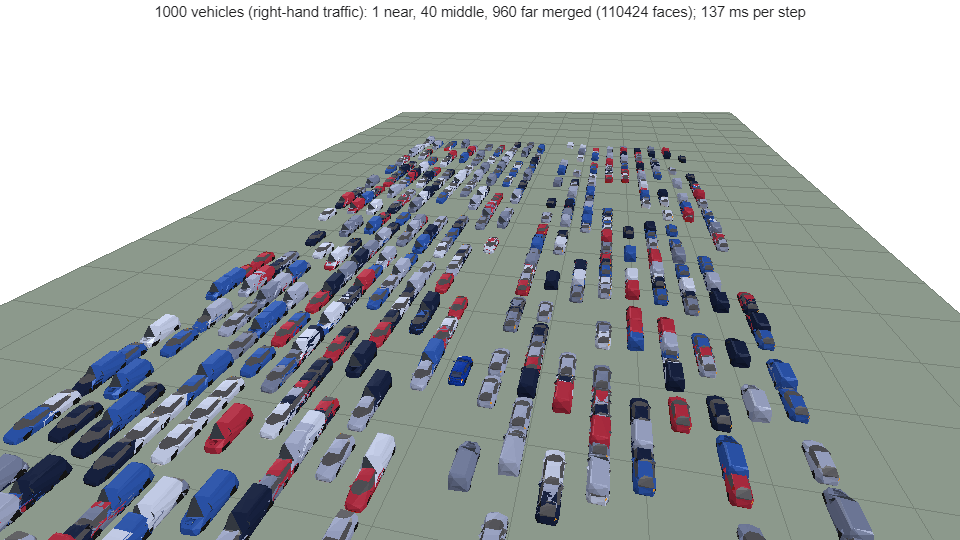 |

| Live data from a watched folder; the display criteria edited while running | Pedestrians at a crosswalk, and a parking gate that rises |
|---|---|
| 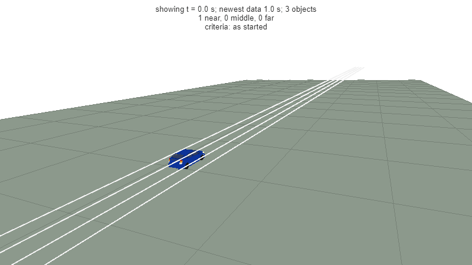 | 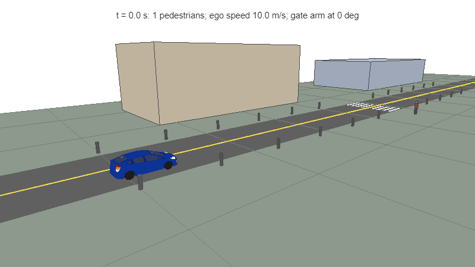 |

| Path lines: (a) the defaults; (b) thin previews, ribbons, a branch palette, and markers |
|---|
| 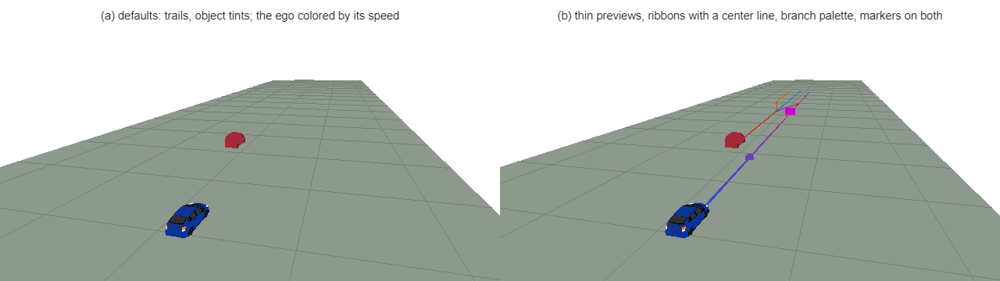 |

## Getting started

1. Put this folder somewhere whose path has **no minus signs**.
2. Open MATLAB (written for R2025b) and run `script_demo_AnimateCar3D.m` from this folder.
3. The first run, while online, installs its dependencies (DebugTools and CarMesh3D) into the `Utilities` folder, which git ignores.

### Which copy of CarMesh3D is used

Exactly one copy of CarMesh3D is kept on the MATLAB path; the demo script removes any others. If two copies were on the path, MATLAB would silently use whichever came first, and a test could pass against the wrong version.

| Setting in `script_demo_AnimateCar3D.m` | CarMesh3D used |
|---|---|
| `flag_useWorkingCarMesh3D = 0` (default) | The newest release installed in `Utilities` (`Utilities/CarMesh3D_<date>`) |
| `flag_useWorkingCarMesh3D = 1` | A working copy, for developing both libraries together: `workingCarMesh3DFolder` if set, otherwise the folder in the environment variable `ANIMATECAR3D_CARMESH3D_PATH`, otherwise a `CarMesh3D` folder next to this one |

Setting `ANIMATECAR3D_CARMESH3D_PATH` (for example `setenv('ANIMATECAR3D_CARMESH3D_PATH','C:\...\CarMesh3D')`) turns the working copy on without editing the script. The script prints which copy it uses, and stores its folder in the environment variable `MATLABFLAG_ANIMATECAR3D_CARMESH3D_ROOT`.

### Checking CarMesh3D (the contract)

`fcn_AnimateCar3D_checkCarMesh3D` checks that the CarMesh3D copy in use still provides everything AnimateCar3D relies on. Run it after installing a new CarMesh3D release, or while changing a working copy:

```matlab
checkReport = fcn_AnimateCar3D_checkCarMesh3D(FigNum=1);   % table of results in figure 1
```

It stops with an error that lists every failed check (or only reports them with `ThrowError=false`). It checks seven things:

| Category | Checks that... |
|---|---|
| `functions` | every CarMesh3D function AnimateCar3D calls exists, exactly once on the path, in the copy being checked |
| `inputs` | each function takes the same number of required inputs, and still has every Name=Value option AnimateCar3D uses |
| `motionColumns` | `fcn_CarMesh3D_saveMotionCSV` writes the 30 standard motion columns in order, and `fcn_CarMesh3D_loadMotionCSV` returns every field AnimateCar3D reads |
| `meshFields` | a mesh made by the CarMesh3D workflow, and a finished mesh from its `Data` folder, have every field AnimateCar3D reads |
| `plotting` | `fcn_CarMesh3D_plotVehicle` returns the handles AnimateCar3D moves, and moves the vehicle when called again with `PlotHandles` |
| `vehicleFolders` | vehicle folders follow the `YEAR_Make_Model_Trimline` rules and file names (including the levels file, `vehicleLevels_<ID>.mat`), and the reference vehicle list has its columns |
| `detailLevels` | the detail levels (made from the sample car with `fcn_CarMesh3D_makeDetailLevels`, and a levels file read with `fcn_CarMesh3D_loadDetailLevels`) have the fields AnimateCar3D reads, in the format version it knows (1): levels from finest to coarsest, the last a box, each level's mesh with a finished mesh's fields |

The full list (the "contract") is in `fcn_INTERNAL_defaultContract` inside the function. **When AnimateCar3D starts using another CarMesh3D function, option, or field, add it to the contract**, so that a later CarMesh3D change that breaks it is caught here first.

## The scene player (step 1)

Four functions draw a scene step by step. The display list is the only thing the player sees, so it does not matter whether the list came from a script (as now), the selector (step 2), or live data (step 3).

| Function | What it does |
|---|---|
| `fcn_AnimateCar3D_loadMeshes` | Loads each vehicle once: its finished CarMesh3D mesh and its ladder of detail levels (from `fcn_CarMesh3D_loadDetailLevels`; made if the vehicle has no levels file; the sample car's are kept in a cache file), with its size, D, and box center for sizes on screen; also the simple shapes (step 4); `MeshSet=` adds to a set already loaded |
| `fcn_AnimateCar3D_fillDisplayList` | Builds the display list for one time step: one row per object, with its mesh, pose, detail tier and level, size on screen, wheel and body motion, lights, color tint, and opacity. `AppendTo=` adds to a list |
| `fcn_AnimateCar3D_playScene` | Draws one display list, keeping the graphics from the step before |
| `fcn_AnimateCar3D_fillBranchMotions` | Test motions: a parent vehicle that splits into decision branches partway through |

```matlab
meshSet = fcn_AnimateCar3D_loadMeshes({'2013_Toyota_Prius_Four','2014_Ford_TransitConnect_XLTCargoLWB'});
fcn_CarMesh3D_plotScene(GroundExtent=[-50 150 -40 40], FigNum=1);     % the scene first
playerState = [];
for k = 1:K
    displayList = fcn_AnimateCar3D_fillDisplayList(Time=t(k), Instance=names, MeshID=meshIDs, ...
        Pose=poses{k}, Tier=tiers{k}, WheelSpin=spins{k});
    playerState = fcn_AnimateCar3D_playScene(displayList, meshSet, PlayerState=playerState, FigNum=1);
    drawnow;
end
fcn_AnimateCar3D_playScene([], meshSet, PlayerState=playerState, Action='clear');
```

**Detail tiers and levels.** Each object in the display list has a tier, and middle and far objects a detail level (see [Detail levels set by size on screen](#detail-levels-set-by-size-on-screen-step-5)):

| Tier | Drawn as | Moves |
|---|---|---|
| `near` | the full CarMesh3D mesh | everything `fcn_CarMesh3D_plotVehicle` does: wheels spin and steer, the body rolls, pitches, and heaves, lights switch |
| `middle` | one of the vehicle's reduced meshes (its `Level`), as its own object | pose only (its transform is set directly) |
| `far` | a reduced mesh, down to a box (simple shapes: their own shape, at every size) | all far objects are merged: the reduced meshes into ONE patch, boxes and simple shapes into another, with vertices updated each step, so thousands of far objects cost little |

A middle or far object's `Level` is an index into its mesh's levels (the selector sets it); if it is NaN, the player takes the level made for its `ScreenSize`; with neither, a middle object gets the finest level and a far object a box.

**Reuse.** When an object leaves the list, its graphics are hidden, not deleted, and the next object that arrives with the same mesh, tier, and level takes them over. An object whose level changes takes the graphics of its new level the same way. Hidden graphics unused for `IdleSteps` steps (default 120) are deleted. In the branching demo, the ego vehicle's graphics become one of the branches at the split.

**Style.** `Color=` tints by part: every part but the glass, wheels, and lamps, face by face, whatever their opacity (so a model with opaque windows keeps them dark). `Alpha=` makes the whole vehicle see-through (near and middle; merged objects are drawn opaque). Both are reapplied only when they change.

**The scene's axes is never changed.** Each new vehicle is drawn in a hidden scratch axes and then moved into the scene. (Drawing straight into the scene would let `fcn_CarMesh3D_plotVehicle` reformat the axes and add lights, because the scene's own objects, from `fcn_CarMesh3D_plotScene`, are hidden handles that `fcn_CarMesh3D_plotVehicle` does not see.) If the scene has no lights, the player adds CarMesh3D's two standard lights.

### Frame rate

`script_AnimateCar3D_frameRateTest.m` times the player with synthetic traffic on 19 lanes around an ego vehicle (a 200 m window that moves with the ego, so the density stays the same), seen from a camera 38 m behind and 34 m above it, in a 960 x 540 figure. Traffic keeps to the right: lanes to the right of the ego's direction drive "up" the screen (+x), lanes to the left drive down; the ego drives in the first lane to the right, which is otherwise empty. A stand-in for the selector applies its rule (sizes on screen): up to 10 vehicles larger than 105 px are near, up to 40 larger than 37 px middle, and the rest far, each at the level made for its size (far vehicles larger than 37 px, merged only because the middle count is full, at the level made for 37 px). Each step's time is split into the player's update and MATLAB's drawing (`drawnow`). Three kinds of runs:

- **all near:** every vehicle with its full mesh (no tiers);
- **levels:** tiers and detail levels by size on screen, as above;
- **boxes far:** the same tiers, but middle vehicles all at the finest level and far vehicles as boxes (as before detail levels), to measure what the merged levels cost.


| Run | Vehicles | Near / middle / far (mean) | Merged faces | Update [ms] | Draw [ms] | Steps per second |
|---|---|---|---|---|---|---|
| all near | 25 | 26 / 0 / 0 | 0 | 10 | 34 | 23 |
| all near | 50 | 51 / 0 / 0 | 0 | 20 | 38 | 17 |
| all near | 100 | 101 / 0 / 0 | 0 | 37 | 67 | 10 |
| levels | 100 | 1 / 40 / 60 | 5900 | 10 | 20 | 34 |
| levels | 250 | 1 / 40 / 210 | 23100 | 14 | 25 | 26 |
| levels | 500 | 1 / 40 / 460 | 53000 | 23 | 41 | 16 |
| levels | 1000 | 1 / 40 / 960 | 110000 | 42 | 71 | 9 |
| boxes far | 250 | 1 / 40 / 210 | 0 | 12 | 22 | 30 |
| boxes far | 1000 | 1 / 40 / 960 | 0 | 30 | 23 | 19 |

(MATLAB R2025b, on the development computer, 2026_11_20; numbers will differ on other computers, and vary by a few milliseconds from run to run. Full results: `Data/frameRate_results.csv`. The near count is 1, the ego, because from this camera no traffic vehicle is larger than 105 px.)

What this shows:
- Without tiers, the time grows with every full mesh: 100 vehicles drop to 10 steps per second.
- Merged levels cost faces, and faces cost drawing time: about 0.5 ms per 1000 merged faces here. Up to about 250 vehicles in this view they run at 26 steps per second or more; at 1000 they are 9, against 19 with boxes.
- **The cap on vehicles past the middle count.** In this dense test, most far vehicles are large on screen: at 1000 vehicles, about 520 of the 960 are 37 px or larger, merged only because 40 are already drawn as middle. Drawn at the level made for their own size, they held 82% of the merged faces (232000 in all, 5 steps per second). The selector draws them at the level made for `MergeBelowSize` (37 px), which halves the merged faces and nearly doubles the frame rate at 1000 vehicles. Those vehicles have fewer faces than the density standard asks for; raise `MiddleCount` to draw more of them at full density.
- The controls are `MiddleCount`, `MergeBelowSize`, `MinScreenSize`, `MaxDistance`, and the figure size.

**New graphics, and level switches.** The player makes a vehicle's graphics the first time it needs a mesh at a tier and level with no free graphics to reuse: most often when a middle vehicle moves to another detail level. Over each run's 40 timed steps (2 s of traffic):

| Run | Vehicles | Steps that made new graphics | Graphics made | Player's time on those steps [ms] | On the other steps [ms] |
|---|---|---|---|---|---|
| levels | 100 | 7 of 40 | 8 | 18 | 8 |
| levels | 250 | 4 of 40 | 4 | 22 | 13 |
| levels | 500 | 4 of 40 | 4 | 32 | 22 |
| levels | 1000 | 3 of 40 | 3 | 48 | 41 |
| boxes far | 250 | 2 of 40 | 2 | 22 | 11 |
| boxes far | 1000 | 2 of 40 | 2 | 38 | 29 |

Making one vehicle's graphics costs about 6 to 11 ms, on a few steps a second; averaged over all steps, about 1 to 2 ms per step (6% at most). Even with one level for every middle vehicle (the "boxes far" runs), graphics are made on 2 steps of 40, because middle vehicles also come and go; so limiting the levels used would remove at most about half of these spikes. Not worth a setting for now (see [TO-DO](#to-do)).

**The demonstration** (`Images/denseTraffic_1000vehicles.gif`, made by the same script, `flag_saveGif`): 1000 vehicles with detail levels for 5 s, with the tiers, merged faces, and time per step in the caption.


## Scenes: catalog and selector (step 2)

The full pipeline, as in [The planned workflow](#the-planned-workflow):

```matlab
% At start
sceneList   = fcn_AnimateCar3D_loadSceneList('Data/myScene.csv');            % what each object is
staticScene = fcn_AnimateCar3D_loadStaticScene('Data/staticScene_cubeGrid.csv');
catalog     = fcn_AnimateCar3D_buildCatalog(sceneList, Motions=motions, StaticScene=staticScene);
meshSet     = fcn_AnimateCar3D_loadMeshes({'2013_Toyota_Prius_Four','box'});
criteria    = fcn_AnimateCar3D_fillDisplayCriteria();                          % follow the camera's view
fcn_CarMesh3D_plotScene(GroundExtent=[-100 300 -80 80], FigNum=1);

% Each time step
selectorState = [];  playerState = [];
for k = 1:K
    egoState = fcn_AnimateCar3D_getObjectState(catalog, 'ego', t(k), Detail='pose');
    fcn_CarMesh3D_updateCamera(cameraSettings, egoState.Pose, AxesHandle=gca);  % camera first
    [displayList, selectorState] = fcn_AnimateCar3D_selectObjects(catalog, t(k), criteria, ...
        SelectorState=selectorState, Camera=gca);
    playerState = fcn_AnimateCar3D_playScene(displayList, meshSet, PlayerState=playerState, FigNum=1);
    drawnow;
end
fcn_AnimateCar3D_playScene([], meshSet, PlayerState=playerState, Action='clear');
```

| Function | What it does |
|---|---|
| `fcn_AnimateCar3D_loadSceneList` | Reads the scene list (CSV file, table, or structure array): one row per moving object |
| `fcn_AnimateCar3D_loadStaticScene` | Reads the static scene: objects that never move |
| `fcn_AnimateCar3D_loadTrafficFile` | Reads many vehicles from ONE narrow "long" file (one row per vehicle per time step), giving a scene list and motions |
| `fcn_AnimateCar3D_buildCatalog` | Builds the object catalog: what exists, when, and where, in a grid of cells per time window; cached in a `.mat` file if asked |
| `fcn_AnimateCar3D_getObjectState` | Any object's state at a time (pose, wheels, body motion, lights); for example, to point the camera at the ego before selecting |
| `fcn_AnimateCar3D_fillDisplayCriteria` | The display criteria, with defaults; any field can be changed while the animation runs |
| `fcn_AnimateCar3D_selectObjects` | The selector: builds each step's display list from the catalog and the criteria |

### Input files

**Scene list** (`fcn_AnimateCar3D_loadSceneList`): one row per moving object; only `instance` is required.

| Column | Meaning | Default |
|---|---|---|
| `instance` | a unique name (e.g. `ego`, `car12`, `ego_brake`) | (required) |
| `role` | `ego`, `traffic`, `confederate`, `pedestrian`, or `movingItem` | `traffic` |
| `meshID` | a CarMesh3D vehicle ID, `sample`, or a simple shape: `box`, `bar`, `cylinder`, `pedestrian` (see [Pedestrians and moving items](#pedestrians-and-moving-items-step-4)) | `sample` |
| `motionFile` | the object's CarMesh3D motion CSV (relative to the scene list's folder), or empty if its motion is given in memory | empty |
| `branchOf`, `branchID` | the instance it branches from, and which branch it is | empty, 0 |
| `splitTime` | when it splits from `branchOf` | the start of its motion |
| `respondsTo` | for an ego branch, the confederate branch it answers | empty |
| `color`, `alpha` | `"r g b"` (0 to 1), and opacity | the role's default |
| `timeOffset` | seconds added to the motion's times | 0 |
| `length`, `width`, `height` | size, for objects drawn as boxes | the mesh's size |

**Static scene** (`fcn_AnimateCar3D_loadStaticScene`): `instance`, `meshID` (`box`, another simple shape such as `cylinder` for posts, or a vehicle ID for parked vehicles), `x`, `y`, `z`, `yaw`, `length`, `width`, `height`, `color`. Only `x` and `y` are required. `Data/staticScene_cubeGrid.csv` is the cube grid used in the demos (210 colored 2 m cubes on a 20 m grid, off the road, and five buildings).

**Traffic file** (`fcn_AnimateCar3D_loadTrafficFile`): `id`, `time`, `X`, `Y`, `yaw`, and optionally `length`, `width`, `height`, in any row order. For dense traffic, one such file replaces thousands of per-vehicle motion files. `Data/traffic_fourLaneRoad.csv` (300 vehicles, 15 s at 2 Hz) is the demo's file; the demo writes it if it is missing.

**Motions in memory** (the `Motions=` input of `fcn_AnimateCar3D_buildCatalog` and `fcn_AnimateCar3D_updateCatalog`): a **cell array of motion structures**, matched to the scene list by `Instance`, each with only the fields it needs, for example `Motions={egoMotion, carMotion}` where the ego's motion has wheels and lights and the car's only poses. (A structure array also works, when all the motions have the same fields.) Each motion is checked against the **motion template**; `fcn_AnimateCar3D_buildCatalog()`, called with no inputs, prints it (or returns it, with an output):

| Field | Required | Size | Units | Meaning |
|---|---|---|---|---|
| `Instance` | yes | text | | the object's instance name, as in the scene list |
| `Time` | yes | K x 1 | s | times, increasing |
| `Pose` | yes | K x 3 or K x 6 | m, rad | `[x y yaw]` or `[x y z roll pitch yaw]`: the ground frame, origin on the ground below the rear axle |
| `WheelSpin` | | K x 4 | rad | wheel rotation angles `[FL FR RL RR]` |
| `SteerAngle` | | K x 2 | rad | front road-wheel angles `[left right]`, + to the left |
| `WheelLift` | | K x 4 | m | each tire's height above the road `[FL FR RL RR]` |
| `BodyRoll` | | K x 1 | rad | body roll on its wheels, + right side down |
| `BodyPitch` | | K x 1 | rad | body pitch, + nose down |
| `BodyHeave` | | K x 1 | m | body heave, + up |
| `LightStates` | | K x 1 structure | | light states, as from `fcn_CarMesh3D_loadMotionCSV` |
| `PathColor` | | K x 3 or K x 1 | | the path line's color at each instant: K x 3 an RGB color; K x 1 a value (speed, threat, ...) colored through `PathColormap` (see [Path lines](#path-lines-step-6)) |
| `PathMarker` | | K x 1 | | markers on the path line: 0 for none; n for the display criteria's `MarkerStyles{n}` |

Other fields are ignored, so motions from `fcn_CarMesh3D_loadMotionCSV` (with an `Instance` added) or `fcn_AnimateCar3D_fillBranchMotions` can be given as they are. A field spelled like a template field but differently (`Wheelspin`, `wheel_spin`) is an error that names the right spelling, and a field of the wrong size is an error that names the object and the expected size.

### The object catalog

- **What it keeps:** for each object, its scene list fields, the times it exists (in the scene's clock, with `timeOffset`), and a **thinned path** (one pose every `ThinStep` seconds, default 0.5 s). Full motions are kept in memory only when they were given in memory, for the roles in `KeepRoles` (default `ego` and `confederate`), and for branches. Other objects' motion files are read only when the selector draws them in detail, and only once.
- **The grid:** time is cut into windows (`TimeWindow`, default 1 s) and the ground into cells (`CellSize`, default 25 m). For each window, each cell lists the objects whose path passes through it, with a margin of the object's length. Static objects have their own grid, without time. The selector looks only at the cells around its region, so thousands of objects cost little. (500 vehicles over 60 s build in about 2 s.)
- **Branches:** each parent records when its first branch splits (`BranchStart`); each branch's split time defaults to the start of its motion.
- **Cache:** with `CacheFile=`, the catalog is saved, and loaded again instead of rebuilt as long as the inputs are the same (the same objects and their scene list fields, motions, motion files and their dates, static scene, and settings).

### The selector and the display criteria

The selector runs once per step. Its steps are listed under [Step 2 summary](#step-2-summary-catalog-and-selector-done-2026_11_19). The display criteria decide what it draws:

**Region** (`Region=`): which objects are candidates.

| Region | Candidates | Sizes on screen measured from |
|---|---|---|
| `'cameraView'` (**default**) | objects inside the camera's field of view (plus `ViewMargin`, and the object's own size), up to `MaxDistance` (500 m) | the camera |
| `'circle'` | objects within `Radius` of `Center` | the camera if given; else `Center` |
| `'box'` | objects inside a `BoxSize` rectangle around `Center`, aligned with the global axes or with the center's heading (`BoxAlign`) | the camera if given; else `Center` |

For `'cameraView'`, set the camera for the step first, then pass `Camera=gca` (or a structure with `Position`, `Target`, `ViewAngle`, and optionally `Pixels`, the axes' smaller side, default 450). Without a camera, `'cameraView'` falls back to a circle of radius `MaxDistance` around `Center`. **`Center`** can be `'ego'` (default), any instance name, `'camera'` (the camera's target, so a camera can pan a scene), a fixed `[x y]`, or a function of time `@(t) [x y]` (or `[x y yaw]`).

**Tiers, by size on screen** (pixels; see [Detail levels set by size on screen](#detail-levels-set-by-size-on-screen-step-5)): near above `TopScreenSize` (105 px; up to `NearCount`, 10), middle above `MergeBelowSize` (37 px; up to `MiddleCount`, 40), far down to `MinScreenSize` (1 px; up to `FarCount`, unlimited), and nothing smaller. Objects are placed largest first, whatever their role; one over a count goes to the next tier down. Without a camera, sizes use `NominalScale` (618: an axes 450 px on its smaller side, 40 degrees). Because the tiers are in pixels, the same criteria suit a camera close by or high above the scene, a small figure or a large one, a car or a bus.

**Detail levels:** pass the mesh set (`MeshSet=meshSet`) and each middle and far vehicle gets the coarsest level made for at least its size on screen.

**Hysteresis** (default 10%): an object at a tier keeps it until its size passes the tier's boundary by 10%; a vehicle moves to a finer level as soon as it grows past its level's size, and to a coarser one only once it has shrunk 10% past the boundary. The region grows by the same margin for objects already shown. This stops objects at a boundary from flickering.

**Roles:** `RolesShown` (all), `AlwaysShown` (`ego`, `confederate`: drawn wherever they are), `AlwaysShowBranches` (true), `FixedTiers` (`{'ego','near'}`), `HideParentAtSplit` (true: a parent stops being drawn when its first branch splits off).

**Styles:** an object's own `color` and `alpha` from the scene list, or its role's default: confederates are tinted `ConfederateColor`; branches take their parent's color and `BranchAlpha` (0.35).

The selector returns its state for the next step: each drawn object's tier and level (for hysteresis), the motion files already read, the static lookup, each mesh's size, which objects **entered** and **left** this step, and counts and timing (`Stats`, including `NumTooSmall`). For 200 cars it takes about 2 ms per step.

### The demos

- **A confederate with branches, and the ego's responses** (`script_demo_AnimateCar3D.m`, step 5): a van comes up a side street. At 2.5 s it splits into three maneuvers: it stops, it crosses the road, or it turns right onto the road ahead of the ego. At 3 s the ego splits into three responses, each linked by `respondsTo` to the maneuver it answers: carry on, brake hard, or slow and change lanes. Each maneuver and its response share a color, and brake lights come on when slowing; each branch's trail is drawn in its color from the split point (path lines, the default). The motions are given in memory, and the cube grid is the static scene.
- **Dense traffic from one file, with a panning camera** (step 6): 300 vehicles on a four-lane road from `Data/traffic_fourLaneRoad.csv`. Every fourth vehicle is a van, about one in eight is a truck drawn as a 12 m box, and cars come in six colors. The camera pans at 6 m/s while the ego drives at 13 m/s, so the ego enters the view and then leaves it. Only what the camera sees is drawn, with detail set by distance from the camera.

## Live use (step 3)

In live use, the scene is not known in advance: a simulator (or a vehicle) writes data into a **watched folder** while the animation runs. One function runs the whole live loop, `fcn_AnimateCar3D_playLive`:

```matlab
liveFolder = 'C:\myRun\live';
meshSet = fcn_AnimateCar3D_loadMeshes({'2013_Toyota_Prius_Four','box','pedestrian'});
fcn_AnimateCar3D_playLive(liveFolder, meshSet, GifFile='myRun.gif');   % runs until no new data comes for 10 s
```

Each step, it watches the folder (at most once a second), updates the catalog with only what changed, applies any edit to `displayCriteria.txt`, loads the meshes of new mesh IDs, points a CarMesh3D camera at the object it follows, selects, draws, writes a caption, and saves a GIF frame. The time shown moves with the clock and stays `DisplayDelay` (1 s) behind the newest data, so the picture moves smoothly although data arrives in bursts. If the figure is empty, a ground is drawn first; to use your own scene, draw it before the call. A mesh ID that appears later is loaded then; if it cannot be loaded (a misspelled ID, say), a warning is given once and its objects are drawn as boxes of their size.

| Option | Default | What it does |
|---|---|---|
| `Steps` | `Inf` | `Inf`: run until done. `1`: one step per call, for a script with its own loop (pass `LiveState=liveState` back each time) |
| `StopAfter`, `MaxSeconds` | 10, `Inf` | Stop after this many seconds with no new data (once caught up), or in all. Closing the figure also stops it. `StopAfter=Inf` keeps the animation open however long no data comes (field data collection); while nothing changes, the picture is not redrawn |
| `DisplayDelay`, `PlaybackSpeed` | 1, 1 | How far behind the newest data to stay; scene seconds per clock second |
| `ShowTime` | `[]` | The time to show at this step, in place of the clock (scripted playback, tests) |
| `CheckInterval`, `ForceCheck` | 1, `false` | Seconds between folder checks; check at every step |
| `Criteria`, `DefaultMeshID` | defaults, first mesh | The criteria to start with; the mesh of objects whose files do not name one |
| `CameraSettings`, `CameraFollow` | `'kite'`, `'ego'` | A camera from `fcn_CarMesh3D_fillCameraSettings` (`[]` leaves the camera alone), and the instance it follows |
| `Caption` | `true` | `true`, `false`, or extra text below the standard caption |
| `GifFile`, `GifEvery`, `GifDelay` | `''`, 1, 0.1 | GIF frames, with one fixed color map |
| `Action` | `'play'` | `'clear'` deletes the drawn graphics |

The output `liveState` holds the catalog, criteria, mesh set, the watcher's, selector's, and player's states, and `Done`/`DoneReason` and `Stats`.

Underneath, `fcn_AnimateCar3D_playLive` uses these functions, which can also be called directly to write your own loop (see the function's code, or demo step 7 before 2026_11_20):

| Function | What it does |
|---|---|
| `fcn_AnimateCar3D_watchFolder` | Lists the folder (at most every `MinInterval` seconds, default 1), finds new, grown, changed, and deleted files, reads the new and changed ones, and returns what changed: scene rows and motions to add or replace, instances to remove, a changed criteria file, and the newest time in the data |
| `fcn_AnimateCar3D_updateCatalog` | Adds, replaces, and removes objects in a catalog, touching only their grid entries; starts an empty catalog from `[]`. Building a catalog at once and building it up with updates give the same grid |
| `fcn_AnimateCar3D_changeDisplayCriteria` | Changes some display criteria, from a structure or a text file of `Name = value` lines, and checks the result; `OnError='warn'` keeps the old criteria if a change is bad |
| `fcn_AnimateCar3D_writeLiveTestFiles` | **A test helper only:** stands in for a live source, writing a folder as time goes on (creating, appending to, and deleting files) |

**What the watched folder holds** (names starting with `.`, `_`, or `~` are skipped, so a program can write under such a name and then rename):

| File | Holds |
|---|---|
| `<instance>.csv` | one object's motion in the CarMesh3D motion format (`time`, `X`, `Y`, `yaw`, and any other motion columns); the file name is the instance. It may grow as rows are added; it is read once it has 2 rows |
| `<name>.csv` with an `id` column | many objects in the long traffic format; instances are `<name>_<id>` |
| `sceneList.csv` (optional) | the scene list: roles, meshes, colors, branches, time offsets. It may list objects whose files do not exist yet; a changed scene list restyles the objects already shown without rereading their motions. Objects not in it get `DefaultRole` (`traffic`) and `DefaultMeshID` (`sample`) |
| `displayCriteria.txt` (optional) | changes to the display criteria, one per line, e.g. `MaxDistance = 150`, `RolesShown = ego, confederate`, `FixedTiers = ego near; confederate middle` |

**Grown files: only the new rows are read.** A file that has grown by rows added at its end is not read again whole: the watcher reads only the new rows (with the last row read before, so units, yaw, and wheel spin carry on) and joins them to what it has. So a check costs the same however long the run: with one file grown to 36,000 rows (an hour at 10 Hz), a check with 10 new rows took 23 ms, against 76 ms to read the file whole. (Most of a check's time is the motion reader's fixed cost, about 10 ms per changed file; see Changes wanted in CarMesh3D.) Values the reader works out from neighboring rows (steering and speed from the path, when the file does not give them) may differ slightly at the rows where reads meet.

**Partly written files.** A file may end partway through a row: its complete rows are read now, and the rest once complete. (The scene list and the criteria file are read only once complete.) A file that cannot be read yet (for example, with only one row) is reported in `update.Skipped` and tried again on the next check.

**Deleted and replaced files.**

| What happened to the file | What the watcher does |
|---|---|
| Rows added at its end | reads only the new rows (`update.AppendedFiles`) |
| Deleted | removes its objects, unless another file now holds them (`update.DeletedFiles`, `update.Remove`) |
| Replaced: shorter than what was read; its first bytes or the last row read changed; the same size with a new date; or new rows that go back in time | reads it again whole (`update.ReplacedFiles`); objects no longer in it are removed |
| Deleted and made again between two checks | the same as replaced |
| Edited in the middle, keeping its first bytes and the last row read | **not seen.** To change a file, write a new one under a name starting with `_` and rename it over the old one |
| The scene list deleted | objects go back to the default role and mesh |
| `displayCriteria.txt` deleted | the criteria stay as they are |

The watcher keeps each object's motion read so far, so its memory grows with the data, as the catalog's does.

**Changing the criteria while running.** The selector reads the criteria at every step, so any change (from a script, or from `displayCriteria.txt`) takes effect on the next frame. Nothing else needs resetting: the selector's memory of tiers is kept, so hysteresis still applies.

**Speed.** Growing 200 cars by 1 s each updates the catalog in about 0.12 s. In the live demo (23 vehicles, checked every 0.5 s), each check and catalog update took about 0.12 s on average.

**The live demo** (`script_demo_AnimateCar3D.m`, step 7): the test helper writes an ego vehicle and 22 traffic vehicles into a temporary folder, one file per vehicle; each file appears when its vehicle starts and is deleted 1 s after it ends. Oncoming cars come from 110 m ahead and pass behind the camera. Overtaking cars start 35 m behind the ego (behind the camera), pass it, and pull ahead: each is drawn near, then with ever coarser reduced meshes as it shrinks on screen (separately, then merged), and is no longer drawn once it is beyond `MaxDistance` (150 m) from the camera. The loop is `fcn_AnimateCar3D_playLive`, one step per call (the data is written in the same loop): it checks the folder every 0.5 s and draws 1 s behind the newest data, with a 'kite' camera following the ego. At 4 s, `displayCriteria.txt` is "edited" so that all traffic is merged (`TopScreenSize = 10000`, `MergeBelowSize = 10000`: each vehicle at its detail level, in one patch), and at 7 s back to the defaults. The caption shows the time drawn, the newest data, the number of objects, the tiers, and which criteria are in use.

(In the first version of this demo, the overtaking cars' motions lasted only 8 s and ended just before they reached the ego, so they vanished beside it: an object no longer exists after its last time. That was the demo's traffic, not the selector.)

## Pedestrians and moving items (step 4)

Objects with no vehicle mesh are drawn as **simple shapes** (`fcn_AnimateCar3D_fillSimpleShape`):

| Shape | Origin | Default size [L W H], m | For |
|---|---|---|---|
| `box` | center of its bottom face | 1 x 1 x 1 | buildings, trucks known only by size, train cars, garage doors |
| `bar` | center of its rear end (half way up), so it swings about that end | 4 x 0.12 x 0.12 | gate arms |
| `cylinder` | center of its base (12 sides) | 0.3 x 0.3 x 1 | posts, bollards, poles |
| `pedestrian` | on the ground between the feet, facing +x | 0.35 x 0.55 x 1.75 | people: dark legs, a body in the object's color, and a head |

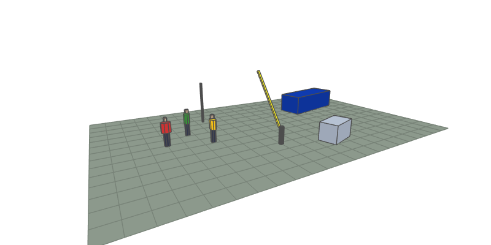

- Give the shape name as the `meshID` in the scene list or static scene (any capitalization), and load it with `fcn_AnimateCar3D_loadMeshes` like a vehicle. A `length`, `width`, `height` in the scene list scales the shape (for example, a shorter pedestrian).
- Simple shapes are always drawn the far tier's way: all of them, with the far vehicle boxes, are **one patch** whose vertices are updated each step. A crowd costs about as much as one vehicle (1000 far objects: about 1 ms to update and 12 ms to draw).
- Unlike far boxes before step 4, every far object now turns in **roll, pitch, and yaw** (the CarMesh3D pose convention), so a moving item's motion can tilt it: a gate arm is a `bar` whose pitch goes from 0 to about -1.45 rad (negative pitch is nose up).
- The roles are `pedestrian` and `movingItem`; both can be filtered with `RolesShown` like any other role.

**The demo** (step 8): the ego slows and stops before a crosswalk while seven pedestrians cross (six one way, one the other, each starting at its own time), then drives on to a parking gate whose arm rises as it comes near. Posts along the sidewalks are static cylinders. The camera follows the ego.

## Path lines (step 6)

Path lines show where objects have been (a **trail**) and, optionally, where they will go (a **preview**), drawn on the ground. The selector lists them in the display list (`displayList.Paths`, with `displayList.PathStyle`), chosen by the display criteria, and the player draws them, so a scene loop gets them with no extra code. A script can also add its own paths to a display list.


**Which objects.** When any member of a **family** (a parent and its branches) is drawn, every member's path is drawn (`BranchPaths`, on by default), so the alternatives can be compared. Other roles get paths while they are drawn if listed in `PathRoles` (for example `{'ego','pedestrian'}`). **At a split, each branch's line starts at the split point and its parent's line runs up to it**: this is fixed, not an option, so the picture is never ambiguous.

**The settings** (display criteria; defaults in brackets):

| Setting | Default | Choices |
|---|---|---|
| `BranchPaths` | true | paths for every member of a drawn family |
| `PathRoles` | {} | other roles with paths while drawn |
| `PathTrail` | true | draw trails |
| `PathPreview` | 'none' | 'none', 'thin' (half as wide), or 'same' (as the trail). Live objects have no known future, so no preview |
| `TrailSeconds`, `PreviewSeconds` | Inf, Inf | how far back a trail and how far ahead a preview reach |
| `PathLineType` | 'line' | 'line' (screen lines: the same width in points at any distance), 'ribbon' (strips on the ground that shrink with distance, like paint), or 'ribbonAndLine' (a ribbon with a 1 pt line down its middle, which never breaks up far away, where a thin ribbon would) |
| `PathLineWidth`, `PathRibbonWidth` | 2 pt, 0.6 m | |
| `PathColorPolicy` | 'object' | 'object' (the object's tint), 'branch' (`PathPalette` by branch number, so branch 2 of the ego and branch 2 of another vehicle match), 'family' (the root object's color), or 'fixed' (`PathColor`) |
| `PathColor` | dark gray | for 'fixed', and for objects drawn in their mesh's own colors |
| `PathPalette` | MATLAB's `lines` colors without the yellow | for 'branch' |
| `PathColormap`, `PathColorLimits` | blue, purple, red; [] | for values (below); [] means the range of all values in the catalog, fixed for the whole scene so colors do not shift as it plays |
| `MarkerStyles`, `MarkerOn` | {{'Marker','o','MarkerSize',6}}, 'trail' | a list of marker styles (each a cell array of line property Name, Value pairs); markers on the 'trail', 'preview', or 'both' |

The defaults avoid white and yellow lines, which look like lane markings.

**Your own colors and markers** come with each object's motion (see the motion template in [Input files](#input-files)):
- `PathColor`, K x 3: an RGB color at each instant; or K x 1: a value at each instant (speed, the "threat" seen by a maneuver, ...) colored through `PathColormap`. AnimateCar3D only draws these; computing them is up to you. An object with its own `PathColor` is always drawn in it, whatever `PathColorPolicy` says.
- `PathMarker`, K x 1: 0 for no marker, or n to draw `MarkerStyles{n}` at that instant, for example `MarkerStyles={{'Marker','o'}, {'Marker','s','MarkerSize',20,'Color',[1 0 0]}}` with 1 where the ego starts braking and 2 where a threat passes a limit. A style without `'Color'` takes the path's color there. An index past the list is an error that names the object.

**The demo** (step 9): the same scenario twice, side by side: (a) the defaults, with the ego's trail colored by its speed (8 to 14 m/s); (b) thin previews, ribbons with a center line, the branch palette, and markers on both (a circle at 2 s, a square at 5 s). A van ahead has three maneuvers from 3 s: keep its lane, move left, or cut in.

**How the choices were made.** Ribbons and screen lines were compared on one scene (screen lines are cleanest at every distance but give no sense of depth; ribbons look like paint near the camera but break up far away; a ribbon with a center line keeps both); all three are options, with screen lines the default. Dashed lines were ruled out.

## Roads and simple scenes (prototype)

Most example scenarios need a road under them. Three prototype functions describe, locate, and draw roads. They are laid out like **ASAM OpenDRIVE**, the standard for road networks, so that a later scene-building repository can read and write OpenDRIVE (`.xodr`) files with little change. Moving things (vehicles, pedestrians) stay in the scenario: the scene list and motions, which play the part of **ASAM OpenSCENARIO**.

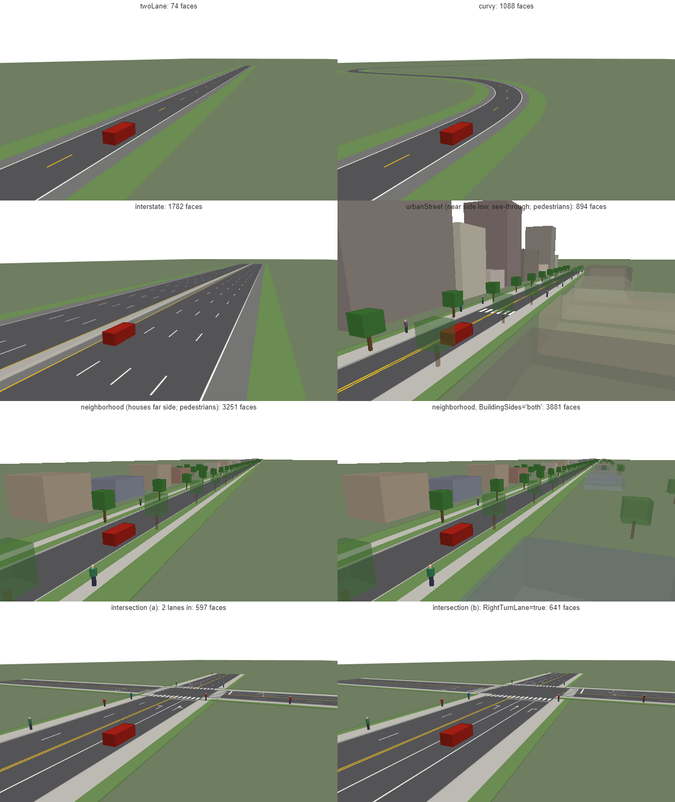

*All seen from the same camera: 22 m behind a car (red box) in the first driving lane, 16 m to its right, and 10 m up (at s = 45 m; at the intersections, 35 m out on the west arm, coming in). Below, the two intersections from above.*

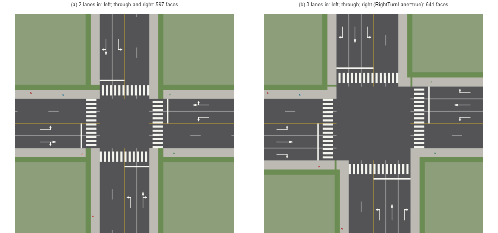

| Function | What it does |
|---|---|
| `fcn_AnimateCar3D_fillRoad` | Fills a road from a preset (`'twoLane'`, `'curvy'`, `'interstate'`, `'urbanStreet'`, `'neighborhood'`) with options (length, lane width, lanes each way, center mark, start pose, random seed, building setback and sides, block length) |
| `fcn_AnimateCar3D_getRoadPoints` | World points `[x y heading]` from road coordinates: s along the reference line, t across it (left positive), or a lane and an offset, as an OpenSCENARIO `LanePosition`. To place a vehicle, use `DrivingLane` (the k-th driving lane: -1 is the first on the right), which skips medians and shoulders; OpenDRIVE's `LaneID` -1 is the first lane of any type (on the interstate, the median) |
| `fcn_AnimateCar3D_plotRoad` | Draws the lane surfaces (colored by lane type, with curb steps), the road marks, and the road objects, in three patches (plus one per opacity for see-through objects: `NearSideAlpha`, 0.3, for near-side buildings and trees; `BuildingAlpha` for all buildings). Curves are sampled every 2 m, straight lines every 50 m: the two-lane road is 74 faces, the neighborhood (1200 m, with houses) about 2,400 |

**How a road is described** (OpenDRIVE terms in brackets):

- **Reference line** (`<planView>`): lines, arcs, and spirals (clothoids, whose curvature changes linearly, so that lines and arcs join smoothly). Each starts at its own s, x, y, and heading.
- **Lanes** (`<laneSection>`): numbered from the reference line outward, negative on the right and positive on the left. Lane 0 is the reference line itself and carries only a mark. Each lane has a type (`driving`, `shoulder`, `border`, `median`, `curb`, `walking`, ...), a width (a cubic in s), and a height (curbs and sidewalks).
- **Road marks** (`<roadMark>`), on each lane's outer edge: `solid`, `broken`, and double lines, in white (`standard`) or yellow, with a width, and line and space lengths (3 m and 9 m by default, about the US 10 ft and 30 ft).
- **Objects** (`<object>`): concrete barriers (swept along the road, as `<repeat>`), crosswalks (continental stripes), stop lines, lane arrows, block trees, buildings (boxes), and standing pedestrians (scenery only: moving pedestrians belong in the scenario).
- **Road networks:** the intersection is four roads and a `<junction>`; `fcn_AnimateCar3D_plotRoad` draws a single road or a network, and `fcn_AnimateCar3D_getRoadPoints` works on each road of a network (`network.Roads(k)`).
- **Procedural, and repeatable:** the lane layouts are fixed by each preset and its options; buildings, houses, parks, and pedestrians are placed at random from `Seed`, so the same `Seed` always gives the same scene, and another `Seed` a different one.

Colors are flat and simple. Only the road marks and crosswalks are white or yellow, so nothing else looks like a lane line.

### The simple scenes

| Scene | Road | Status |
|---|---|---|
| **Two-lane road** | straight, undivided, one 3.6 m lane each way; broken yellow center line (`CenterMark='solid solid'` for no passing); solid white edge lines; 1.8 m shoulders; grass | done: `'twoLane'` |
| **Curvy road** | the same, curving left (60 m radius) and right (50 m), joined by spirals | done: `'curvy'` |
| **Interstate** | divided, 4 lanes each way (`LanesEachWay`); broken white lane lines; solid yellow inside and solid white outside edge lines; 1.2 m inside and 3 m outside shoulders; a concrete (Jersey) barrier on the median | done: `'interstate'` |
| **Urban street** | two lanes, double yellow line; curbs 0.15 m high; 2.5 m sidewalks; a crosswalk; block trees; buildings made at random (repeatably, from `Seed`), occasional pedestrians standing on the sidewalks, set back `BuildingSetback` (6 m) behind the sidewalk, on both sides (`BuildingSides`). The far side is tall (6 to 30 m). The near side (the side of traffic in the right lanes, where a following camera is) is low, mostly one story (3.5 to 4.5 m) with about 1 in 7 two-story (6.5 to 7.5 m), and `fcn_AnimateCar3D_plotRoad` draws its buildings and street trees see-through (`NearSideAlpha`, 0.3), so the camera sees through and over them. Pedestrians are scenario objects, not road objects | street done: `'urbanStreet'`; cross streets wait for intersections |
| **Neighborhood** | two lanes, no center line, 1200 m (three blocks); curbs, a grass strip with street trees, sidewalks, front lawns; small houses on lots about 20 m wide, with an occasional park (a lawn with block trees); occasional pedestrians standing on the sidewalks; a crosswalk at the end of each block (`BlockLength`, 400 m); houses on the far side by default (`BuildingSides`; near-side houses are low and see-through, as on the urban street), `BuildingSetback` (6 m) behind the sidewalk | done: `'neighborhood'` |
| **Intersection** | a road network (OpenDRIVE `<junction>`): four arms meeting at a junction; on each arm 2 lanes out and, in two versions, (a) 2 lanes in (a left-turn lane, and a through and right-turn lane), or (b) `RightTurnLane=true`, 3 lanes in (left, through, right); double yellow center lines; curbs and sidewalks joined at the corners; crosswalks, stop lines, and lane arrows; pedestrians on the sidewalks | done: `'intersection'` (cross streets for the urban scene to come) |

## Folders

| Folder | Contents |
|---|---|
| (root) | `script_demo_AnimateCar3D.m` (the main demo), `script_AnimateCar3D_frameRateTest.m`, this README |
| `Functions` | Functions `fcn_AnimateCar3D_<name>.m`, each tested by `script_test_fcn_AnimateCar3D_<name>.m`; scripts that demonstrate the code more generally are named `script_AnimateCar3D_<name>.m` |
| `Data` | Inputs for the demos: `staticScene_cubeGrid.csv` (static scene), `traffic_fourLaneRoad.csv` (traffic file); and `frameRate_results.csv`. (The live demo writes its watched folder in the system's temporary folder and deletes it afterwards.) |
| `Images` | Images and animations for this README: one GIF per demo step (`branching_tenChoices`, `confederate_branchesAndResponses`, `traffic_cameraPan`, `live_watchedFolder`, `pedestrians_crosswalkGate`), the frame-rate plots, `simpleShapes.png`, and the pictures for the detail-level design (`vehicleTiers`, `detailLevels_fourTiers`, `tintByPart`; the mesh-making pictures are in CarMesh3D's `Images/detailLevels`) |
| `Installer` | The DebugTools installer used by the demo script |
| `Utilities` | Installed dependencies (not in git) |

## The planned workflow

Every object in a scene (the ego vehicle, traffic, pedestrians, gates, buildings) goes through the same stages. All positions are in one global frame.

**At start**

1. **Inputs.**
   - Motion for each object: in memory, one CSV file per object (the CarMesh3D 30-column motion format), or files in a watched folder. Dense traffic may also use a narrow file with one row per vehicle per time step (`id, time, X, Y, yaw`, plus optional size).
   - A **scene list** with one row per object: `instance`, `role`, `meshID`, `motionFile`, `branchOf`, `branchID`, `splitTime`, `respondsTo`, `color`, `alpha`, `timeOffset`.
   - A **static scene**: fixed objects with a mesh, pose, and color.
2. **Object catalog.** Records what exists, when, and where, using a grid of cells per time window so that lookups stay fast with thousands of objects. Full motion is loaded only for objects drawn in detail. The catalog is saved as a cache and reused while the files are unchanged.

**Each time step**

3. **Display criteria.** A region (a radius around an object, a box, or the camera's view), roles to show and to always show, and size-on-screen and count limits for each detail tier. They can be changed while the animation runs.
4. **Selector.** Picks the objects to show at this time, gives each a detail tier and level from its size on screen, and builds the **display list**: the only input of the scene player.
5. **Scene player.** Draws, moves, and hides objects. It never decides what to show, and it treats static and moving objects alike.
   - Near tier: full CarMesh3D meshes, with wheels and lights.
   - Middle tier: reduced meshes (detail levels), each its own object.
   - Far tier: reduced meshes down to boxes, all merged into one patch.

   Leaving objects are hidden and reused rather than deleted.
6. **Frame out.** To the screen, a GIF, or a video.
7. **Live update.** About once a second, new, grown, and deleted files in a watched folder update the catalog.

**At finish:** close output files and delete the reused graphics objects.

**Roles:** `ego`, `traffic`, `confederate` (traffic scripted to challenge the ego, which may branch), `pedestrian`, `movingItem` (gates, trains, garage doors), and `static`. A branch keeps its parent's role, names its parent in `branchOf`, and can split from it partway through the motion (`splitTime`); branches can split again. `respondsTo` links an ego branch to the confederate branch it answers.

## Development plan

0. **Repository setup** (done): template leftovers removed; one copy of CarMesh3D on the path; `fcn_AnimateCar3D_checkCarMesh3D`, which checks every CarMesh3D function, option, mesh field, motion column, and folder rule that AnimateCar3D relies on.
1. **Display list and scene player** (done), fed from memory: reuse of hidden graphics and the three detail tiers. Demo: ten ego branches splitting partway. Frame-rate test from 100 up to 1000 vehicles (20 steps per second at 1000 with far boxes, at the time; see [Frame rate](#frame-rate) for the current numbers).
2. **Scene list, object catalog, selector, and static scene** (done). Demos: a confederate with branches and the ego's responses; dense traffic from one file, with a panning camera (see [Scenes: catalog and selector](#scenes-catalog-and-selector-step-2)).
3. **Live use** (done): display criteria changed while running (from a script, or a file in the watched folder); the watched-folder source; a test helper that adds and removes files in a watched folder (see [Live use](#live-use-step-3)).
4. **Pedestrians and moving items** (done), as simple shapes first (see [Pedestrians and moving items](#pedestrians-and-moving-items-step-4)).
5. **Detail levels set by size on screen** (done): any number of levels, chosen by each object's size in pixels, from a ladder of reduced meshes made by CarMesh3D (see [Detail levels set by size on screen](#detail-levels-set-by-size-on-screen-step-5)).
6. **Path lines** (done): trails and previews on the ground, with color policies, your own colors and markers, and screen lines or ribbons (see [Path lines](#path-lines-step-6)).

Out of scope: a 2D (top-down) mode. It needs different inputs (XY outlines, not XYZ meshes), which CarMesh3D does not make yet, so it will be a separate repository; the outlines are listed in CarMesh3D's TO-DO.

### Step 0 summary: repository setup (done 2026_11_19)

**What was done**
- **Template leftovers removed.** The repository started from the BreakDataIntoLaps template. Removed: the 10 `fcn_Laps_*` functions and their 10 test scripts, `script_demo_Laps.m`, `Documents/LapsLibrary.pptx`, the 11 Laps images, two old BreakDataIntoLaps release zips, and the PlotRoad latitude/longitude settings in the demo script. The README and `Data/README_DATA.md` were rewritten, and the license year set to 2026. The installer (`Installer`) and the dependency setup were kept unchanged.
- **One copy of CarMesh3D on the path.** `script_demo_AnimateCar3D.m` removes every CarMesh3D folder from the MATLAB path on every run, then adds back only the chosen copy, checks that MATLAB finds exactly one copy of the CarMesh3D functions, prints which one it uses, and stores its folder in `MATLABFLAG_ANIMATECAR3D_CARMESH3D_ROOT` (see [Which copy of CarMesh3D is used](#which-copy-of-carmesh3d-is-used)). Tested three ways: the installed release (a session with 14 CarMesh3D folders on the path ended with one), the working copy, and switching back.
- **Naming convention.** Functions are `fcn_AnimateCar3D_<name>.m`; scripts that test a function are `script_test_fcn_AnimateCar3D_<name>.m`; scripts that demonstrate the code more generally are `script_AnimateCar3D_<name>.m`; the main demo keeps the `script_demo_` name. (CarMesh3D was renamed to the same convention in its release `CarMesh3D_2026_11_19b`.)
- **The contract check, `fcn_AnimateCar3D_checkCarMesh3D`** (see [Checking CarMesh3D](#checking-carmesh3d-the-contract)). It checks six categories: functions (16 CarMesh3D functions, each exactly once on the path, inside the copy being checked), inputs (each function's required inputs and Name=Value options, read from its source), motion columns (the 30 standard columns written in order, and the fields read back), mesh fields (the sample car and a finished mesh from CarMesh3D's `Data`), plotting (handles, moving with `PlotHandles`, and the pose convention), and vehicle folders (names, file names, and the reference list). A failure stops with one error that lists every failed check; `ThrowError=false` only reports.

**How it was checked**
- 44 of 44 checks pass against the installed release `CarMesh3D_2026_11_19b` and against the working copy (development mode).
- `script_test_fcn_AnimateCar3D_checkCarMesh3D` also feeds the check four deliberate conflicts (a function that does not exist, an option that does not exist, the old spelling `rollRate` for `roll_rate`, a mesh field that does not exist); each is caught with a clear message.

### Step 1 summary: display list and scene player (done 2026_11_19)

**What was built** (see [The scene player](#the-scene-player-step-1))
- `fcn_AnimateCar3D_loadMeshes`: each vehicle once, as its finished mesh and a low-detail copy (the Prius: 6648 faces down to 471; the Transit Connect: 14984 down to about 300 to 500; below a few hundred faces the count stops falling because wheels and lamps are kept whole), with its size and rear overhang for far boxes.
- `fcn_AnimateCar3D_fillDisplayList`: the list of objects to draw at one step (mesh, pose, tier, wheel and body motion, lights, color, opacity), with `AppendTo=` to combine lists.
- `fcn_AnimateCar3D_playScene`: the player. Objects that leave are hidden and reused by the next arrival with the same mesh and tier; hidden graphics unused for `IdleSteps` steps are deleted. Near objects get everything `fcn_CarMesh3D_plotVehicle` does; middle objects only move (their transform is set directly, with the same pose convention, which the contract check confirms); all far boxes are one patch. Color tints only the body; opacity applies to the whole vehicle; both are reapplied only when they change.
- `fcn_AnimateCar3D_fillBranchMotions`: test motions of a parent that splits into decision branches partway through (each branch starts exactly at the parent's pose and wheel spin, and eases into its own curvature, with Ackermann steering).
- The main demo (`script_demo_AnimateCar3D.m`, step 3) and the frame-rate test (`script_AnimateCar3D_frameRateTest.m`).

**Results**
- **Ten branches** (`Images/branching_tenChoices.gif`): the Prius drives straight for 2 s, then splits into ten paths from a hard left (blue) to a hard right (red). Branches are see-through except the chosen one (solid, with a thicker path). The ego's graphics are reused as one of the branches at the split, so only ten vehicles are ever drawn (10 created, 1 reused over 121 steps).
- **Frame rate** (see [Frame rate](#frame-rate)): without tiers, 25 / 50 / 100 full meshes run at 35 / 20 / 11 steps per second. With tiers (10 near, 40 middle, the rest boxes), 100 / 250 / 500 / 1000 vehicles run at 23 / 27 / 23 / 20 steps per second. The number of vehicles barely matters with tiers: the near and middle limits set the speed. Most of each step is MATLAB's drawing (about 30 to 40 ms), not the player (about 10 ms), so the tier limits and the figure size are the controls.

**How it was checked**
- All five AnimateCar3D test scripts pass; the contract check passes 44 of 44.
- The player's test checks creation, reuse (an arriving object takes over a leaving object's graphics in the same step), hiding and deleting after `IdleSteps`, color and opacity (and restoring them), the box patch, and clearing.
- The branching GIF and the dense-traffic picture were inspected frame by frame.

**Problems found, and how they were handled**
- **The scene's axes was being reformatted.** `fcn_CarMesh3D_plotVehicle` cannot see `fcn_CarMesh3D_plotScene`'s hidden-handle objects, so it treated the scene as an empty axes: it reset the view and limits and added lights, and the first branching GIF came out blank. The player now draws each new vehicle in a hidden scratch axes and moves it into the scene, so the scene's axes is never changed; if the scene has no lights, the player adds CarMesh3D's two standard lights.
- **GIF colors.** `fcn_CarMesh3D_saveGifFrame` picks a new 256-color map for each frame, which turned the thin red paths and red-tinted branches gray. The main demo writes its GIF with one fixed color map (the first frame's 30 main colors, an even spread of 216 colors, and the branch colors).
- Both are listed under [TO-DO](#to-do) as changes wanted in a later CarMesh3D release.

### Step 2 summary: catalog and selector (done 2026_11_19)

**Decisions** (settled before building):
- Hysteresis: 10% by default.
- Ties in a tier go to the nearest object, whatever its role (pedestrians may often be drawn as boxes anyway).
- The region follows the camera's field of view by default: since the goal is to animate, what the camera sees decides what is drawn, and tier distances are measured from the camera. The region can instead be a circle or box around the ego (the default center), any object, the camera's target (to pan a scene), a fixed point, or a point that moves with time.

**What was built:** the seven functions in [Scenes: catalog and selector](#scenes-catalog-and-selector-step-2); the `'box'` mesh in `fcn_AnimateCar3D_loadMeshes` (box objects are always far-tier boxes, sized by their own `length`, `width`, `height`); the cube grid static scene file; and demos 5 and 6 of `script_demo_AnimateCar3D.m`.

**How it was checked:**
- All 12 AnimateCar3D test scripts pass; the contract check passes 44 of 44.
- The selector's test checks that: the ego is near; the tier counts hold; everything drawn is inside the region (or always shown); a parent is hidden after its split and its branches shown, tinted and see-through; the near objects are the nearest; hysteresis keeps a car near until 33 m (30 m x 1.1) and, without hysteresis, only until 30 m; the camera's view draws nothing far behind the camera, and turning the camera shows a different set; a box moving with time, and the camera's target as the center, work; nearby static boxes are drawn and distant ones are not.
- The catalog's test checks branch links, time offsets, which motions are kept in memory, the grid contents, and the cache (used when nothing changed; rebuilt when a motion or a color changed).
- Both new demo GIFs were inspected frame by frame.

**Problems found, and how they were handled:**
- **The cache missed color changes.** The first version of the cache compared only some scene list fields, so after colors were added to the traffic, the demo reloaded the old, colorless catalog. The cache now compares every scene list field, and the test checks a color change.
- **Motions with different fields cannot be joined** into one MATLAB structure array (the ego's motion had wheels and lights; the traffic file's only poses). At first the demo gave the traffic motions the same, empty, fields. (Fixed 2026_11_20: `Motions=` takes a cell array, each motion with only its own fields, checked against a motion template; see [Input files](#input-files).)

**The design, as built:** (Tiers by distance, below, were replaced on 2026_11_20 by sizes on screen in pixels: see [Detail levels set by size on screen](#detail-levels-set-by-size-on-screen-step-5) and [The selector and the display criteria](#the-selector-and-the-display-criteria).)

The selector decides, at each time step, which objects are drawn and at what tier; nothing else does. It runs once per step, between the object catalog and the scene player.

**Inputs:** the time; the object catalog (what exists, when, and where, with roles and links); the display criteria (read fresh every step, so a change takes effect on the next frame); and its own memory of the last step (which objects were shown, at which tier). **Output:** the display list (the same structure `fcn_AnimateCar3D_fillDisplayList` makes), plus which objects entered and left.

**Each step:**
1. **Who exists now:** objects whose time span includes t. A branch exists from its split time; its parent stops being shown when its branches take over.
2. **Who is nearby:** only the catalog's grid cells near the region are checked. Static objects are rechecked only when the region has moved noticeably.
3. **Region test:** see the region choices below.
4. **Always shown:** roles such as `ego`, `confederate`, and every branch skip the region test.
5. **Detail tiers:** nearest first: up to the near count within the near distance, then the middle count within the middle distance, then far boxes out to the far distance. **Ties go to the nearest object, whatever its role** (pedestrians, for example, may often be drawn as boxes anyway). Some roles can have a fixed tier (the ego is always near).
6. **Hysteresis:** an object enters a tier at its distance and leaves it only beyond that distance plus **10%** (the default), so an object near a boundary does not flicker between tiers.
7. **State at t:** pose, wheel spin, steering, body motion, and lights. Full motion is loaded from file only for near and middle objects; far boxes use the catalog's thinned path.
8. **Style from role and links:** branches see-through in their parent's style, confederates in their own color (defaults the scene list can override).

**Region choices** (`Region` in the display criteria):

| Region center | Moves? | Use |
|---|---|---|
| the camera's field of view (**default**) | with the camera | animations: draw what the camera sees |
| the ego vehicle (default center for circle and box) | with the ego | normal driving scenes |
| any named object | with that object | follow a confederate or another vehicle |
| a fixed point or box in the global frame | no | watch an intersection or a parking lot |
| a moving point given by the user (a path, or a function of time) | yes | sweep the region along a route |
| the camera's target (circle or box) | with the camera | let a camera **pan** a complex scene, with the ego vehicle passing into and out of view |

The region shape is a circle (radius) or a box (length and width, aligned with the global axes or with the center's heading). When the region follows the camera, the animation loop passes the camera's current target to the selector each step.

**Display criteria** (`fcn_AnimateCar3D_fillDisplayCriteria`, with defaults, so a script changes only what it needs):

| Field | Default |
|---|---|
| Region | the camera's view (a circle of radius `FarDistance` around the ego if no camera is given) |
| Tier limits | near: 10 within 30 m; middle: 40 within 70 m; far: out to 100 m |
| Hysteresis | 10% (leave a tier beyond 110% of its entry distance) |
| Roles to show | all |
| Always shown | `ego`, `confederate`, and every branch |
| Fixed tiers | `ego` always near |

**Functions:** `fcn_AnimateCar3D_fillDisplayCriteria` (the criteria, with defaults) and `fcn_AnimateCar3D_selectObjects(catalog, time, criteria, SelectorState=state, Camera=axes)`, which returns the display list and its updated memory (the same pattern as the player).

### Step 3 summary: live use (done 2026_11_19)

**Decisions** (taken while building, as the simplest that serve the plan):
- The live source is a folder of files, not a network link: anything that can write a CSV file can feed an animation, and a run can be replayed later from the same folder.
- One file per object (the CarMesh3D motion format) or one long traffic file; the folder's own `sceneList.csv` styles them. A file's name is its instance.
- Objects read from the folder are kept in memory, so a growing file is read once per check, not again by the selector.
- The criteria are changed by editing a small text file in the same folder, so a person can change what is shown without stopping the animation; a typing mistake gives a warning and keeps the old criteria.
- The loop, not the watcher, decides when to draw: it draws a little behind the newest data (1 s in the demo), so every object has its data for the time drawn.

**What was built:** the four functions in [Live use](#live-use-step-3), and demo step 7.

**How it was checked:**
- All 17 test scripts pass; the contract check passes 44 of 44.
- The catalog update's test: a catalog built up from nothing, one update at a time, has exactly the same grid as one built at once; a grown motion is seen by the selector; removed objects leave no grid entries and their parent loses its branches; an object added back reuses its slot; a changed scene row with no motion keeps its motion (and changes no grid entries); a motion file that grows is read again.
- The watcher's test: new, grown, and deleted files; a scene list change restyles without rereading motions; the criteria file is reported; nothing is checked before `MinInterval`; a file cut off partway through a row is skipped, then read once complete; and the watcher, the test helper, and the catalog update together give the same catalog as building it from the full motions.
- The criteria test: a text file with every kind of value (text, numbers, a list, true or false, tier pairs), changes kept and others untouched, and bad names or values caught (or, with `OnError='warn'`, ignored with a warning).
- The live demo GIF was inspected frame by frame (traffic as boxes from about 3 s, in detail again from about 6 s, the times drawn being 1 s behind the edits), and the tiers of the overtaking cars were logged over the run (near, middle, box, then not drawn as they pull away).

**Problems found, and how they were handled:**
- **A catalog update was too slow for once a second.** Growing 200 cars by 1 s first took 0.78 s, nearly all of it working out each object's grid cells window by window, twice (old and new). The grid cells are now worked out with one interpolation per object, and each object's cells are kept in the catalog (`ObjectKeys`) for the next update: 0.12 s.
- **`string(NaN)` is a missing string in MATLAB, not "NaN"**, so writing empty numbers failed in the test helper (and left a file open, which stopped the folder from being deleted). Numbers are now written by a small helper that leaves NaN empty, and files are closed even when writing fails.

### Step 4 summary: pedestrians and moving items (done 2026_11_19)

**What was built:** `fcn_AnimateCar3D_fillSimpleShape` (box, bar, cylinder, pedestrian); simple shapes in `fcn_AnimateCar3D_loadMeshes` (and its new `MeshSet=` option, which adds only meshes not yet loaded, for live use when new mesh IDs appear), `fcn_AnimateCar3D_fillDisplayList`, and `fcn_AnimateCar3D_selectObjects` (all always far); the player's far patch now draws each object in its own shape, turned in roll, pitch, and yaw; and demo step 8.

**How it was checked:**
- The shape test: every shape is of unit size before scaling, with its origin where documented, and every face's corners in the documented order.
- The player test: pedestrians, a raised gate arm, a post, and a far car in one patch, with the right vertex and face counts, the raised arm's top 5 m up (1 m post plus its 4 m length), and every face lit on its outside.
- 1000 far objects still take about 1 ms to update and 12 ms to draw.
- The crosswalk GIF and a still of every shape (`Images/simpleShapes.png`) were inspected.

**Problems found, and how they were handled:**
- **Far boxes were lit on their inside faces** (this was there since step 1: buildings and trucks looked dark on the sides the light falls on). MATLAB takes a patch face's normal from its corners in the clockwise order, and the boxes listed them the other way round. The player now reverses each face's corners; the test checks the order.
- **The player's first call took over the current figure.** Making its hidden scratch figure made that the current figure, so a `title`, `campos`, or caption right after the first step went to the hidden figure. The player now hands the current figure back to the scene.
- **The demos' titles never showed** with the camera placed by hand (the title fell outside the figure). The demo animations now use a caption at the top of the figure instead; all five demo GIFs were made again, so the step 5 and 6 GIFs now show their captions, and the step 6 buildings and trucks are lit correctly.

## Detail levels set by size on screen (step 5)

> **Status:** built (2026_11_20), with CarMesh3D release `CarMesh3D_2026_11_20`. **The reduced meshes are made by CarMesh3D** (see its README, "Detail levels for animation"): the size-on-screen standard, the density rule, the ladder of levels, the closed-hull method, and the window-color study are described there. This section covers AnimateCar3D's side: choosing a level for each object every frame, and drawing it.

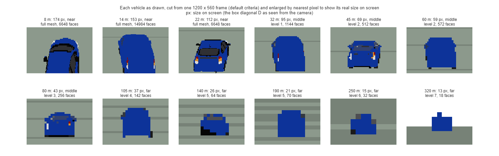

### Why change

Until step 5, a vehicle's detail was set by its distance from the camera: near within 30 m, middle within 70 m, a 5-face box within 100 m, nothing beyond. Three problems showed up:

1. **The low-detail meshes had defects, and the box does not look like a vehicle.** The middle mesh came from `fcn_CarMesh3D_simplifyMesh`, which opens gaps between a downloaded body's separate panels when it reduces them (around the Prius's rear wheel, for example).
2. **Three tiers are not enough for long views.** On a highway one can see 200 m and more, where a vehicle is still several pixels long.
3. **Meters are the wrong unit.** How much detail can be seen depends on how big an object is *on screen*: that changes with the window size and view angle (in a 1920 x 1080 window everything is 2.4 times bigger than in 800 x 450) and with the object's own size (a 12 m bus at 80 m looks as big as a 4.5 m car at 30 m). A threshold in meters suits one vehicle in one window.

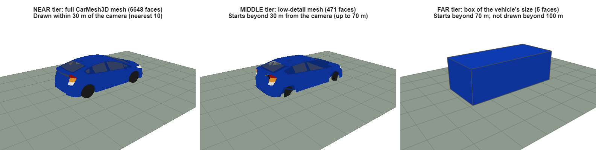

### Who does what

| CarMesh3D (making) | AnimateCar3D (choosing and drawing) |
|---|---|
| Each object's size D and bounding-box center, saved with it | Each object's size on screen, every frame |
| A ladder of reduced meshes, each made for a largest size on screen, at about 0.2 visible faces per pixel | Which level to draw: the rule below, with hysteresis and caps |
| The levels file, `vehicleLevels_<ID>.mat`, and `fcn_CarMesh3D_loadDetailLevels` | How to draw each level: separately, or merged into one patch |
| Checking the levels (pictures, face counts) | Tinting by part; the contract check of the levels file |

Because every level says which size on screen it was made for, AnimateCar3D does not need to know how levels are made or how many there are, and CarMesh3D does not need to know AnimateCar3D's settings: the two only share the size standard and the file's fields, which the contract check checks.

### Size on screen (the shared standard)

- **D:** the diagonal of the object's bounding box in its own frame (from its min to its max x, y, z), from the levels file (for simple shapes, from their size).
- **Distance:** from the camera to the center of that box (turned and moved by the object's pose).
- **Size on screen**, pixels: `size = D x (the axes' smaller side, pixels) / (2 x distance x tan(CameraViewAngle / 2))`. MATLAB's `CameraViewAngle` spans the smaller side of the axes (its `Position` in pixels, not the figure; measured with axes of four shapes, see CarMesh3D's README). For an axes 450 px on its smaller side with a 40 degree view angle, `size = D x 618 / distance`: a Prius (D = 5.14 m) is 105 px at 30 m and 21 px at 150 m. The demos' 800 x 450 figures have MATLAB's default axes, only 620 x 367 inside them, so there `size = D x 504 / distance`.

The selector works this out for every candidate, every step, from the camera it already gets (`Camera=`; for a camera structure, `Pixels` is the axes' smaller side, default 450). Without a camera (circle or box regions), it uses `NominalScale` (618: an axes 450 px on its smaller side, 40 degrees), from `Center`. D and the box come from the mesh set (`MeshSet=`); without one, from the object's `Size`, or a typical car's (4.5 x 1.8 x 1.5 m, its box center 0.3 of its length ahead of the origin).

### Choosing a level

- **The full mesh while the object is larger than `TopScreenSize`** (105 px, the ladder's top): the only level with spinning and steering wheels, body motion, and switching lights.
- **Otherwise, the coarsest level made for at least the object's current size** (the levels' `MaxScreenSize`). An object is never drawn with less than the standard density; the ladder's steps (each level about half the faces of the one above) only decide how many extra faces it may carry, at most about twice. (A small mesh's ladder can start below 105 px: CarMesh3D skips a level that would need as many faces as the full mesh. The sample car, 636 faces, starts at 74 px; above that, as a middle object, it is drawn with its full mesh, which is then the cheaper choice.)
- **A box** below the ladder's last mesh (about 9 px for the Prius); **not drawn** under `MinScreenSize` (default 1 px).
- **Hysteresis** in pixels (10%): a tier is kept until the size passes its boundary by 10%. A vehicle moves to a **finer** level as soon as it grows past its level's `MaxScreenSize` (never too few faces), and to a **coarser** one only once it has shrunk 10% past the boundary.
- **Caps:** at most `NearCount` objects drawn with the full mesh (default 10) and `MiddleCount` drawn as separate reduced meshes (default 40), largest on screen first; one over a cap is drawn in the next tier down. A vehicle merged only because the middle count is full (larger than `MergeBelowSize`) gets the level made for `MergeBelowSize`, not for its own size: this bounds the merged patch to about 130 faces per vehicle, at the cost of less than the standard density for those vehicles.
- **A maximum distance**, `MaxDistance` (500 m), only bounds the selector's search of the catalog's grid, since a bus is still a pixel at 7 km.
- **Simple shapes** (pedestrians, posts, gate arms) have only a few faces: drawn as they are at every size (always merged), and not drawn under `MinScreenSize`.
- Not built: limiting the levels used (for example, only every other level for objects drawn separately, where a switch costs new graphics). See [TO-DO](#to-do).

### Drawing the levels

| Drawn as | When (defaults) | How |
|---|---|---|
| Full mesh (`near`) | over 105 px | `fcn_CarMesh3D_plotVehicle`, with wheels, body, and lights |
| Separate reduced meshes (`middle`) | 37 to 105 px (`MergeBelowSize = 37`) | each level's mesh drawn once with `fcn_CarMesh3D_plotVehicle`, then one transform per object, set directly; graphics reused by the next object with the same mesh and level |
| Merged (`far`) | under 37 px | all such vehicles in ONE patch, each in its own level's mesh (corners reversed for MATLAB's lighting, prepared once per mesh and level), vertices updated each step; boxes and simple shapes in a second patch, with edges |

Merging is what keeps thousands of far objects cheap, but merged faces add up (about 0.5 ms of drawing per 1000 faces in the frame-rate test; see [Frame rate](#frame-rate)). The caps and `MergeBelowSize` are the controls.

The four levels first tested, each at its starting distance in the 800 x 450 view (the Prius; face counts from the first test, before the ladder was settled):

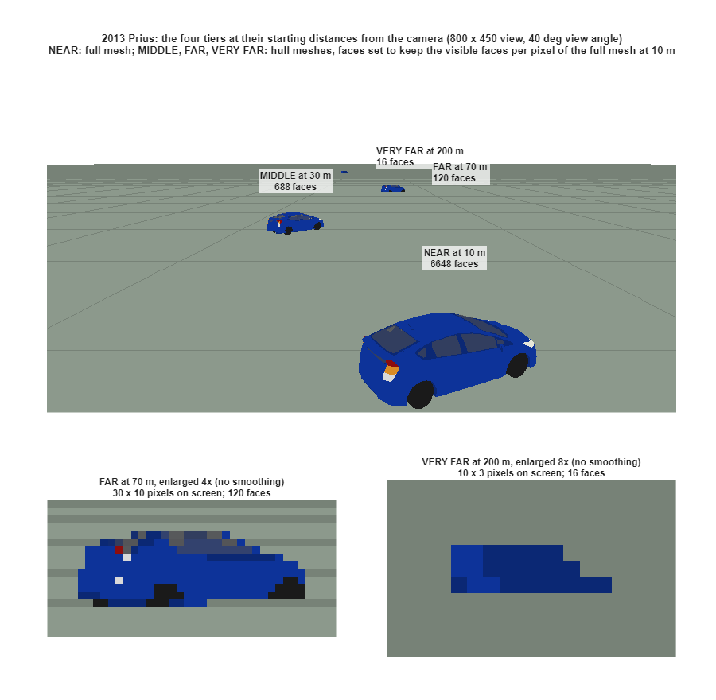

### Tint by part

Until step 5, the player's `Color=` tinted every fully opaque face on the vehicle's body (all but lamps), which left windows alone only because the meshes' glass so far was see-through (alpha 0.6). An opaque window (for example in a downloaded model with opaque glass) was tinted like paint. The player now tints by part: every part except glass, wheels, and lamps. `fcn_CarMesh3D_plotVehicle` puts the body, trim, and any opaque glass in one patch, so each patch's faces are matched to the mesh's faces (by their centers, which stay in the vehicle's own frame) when its graphics are made, and only the body and trim faces are tinted. Merged vehicles are tinted the same way, from each level's `FacePartIndex`. This was found while testing window decals for the reduced levels (tried and not used; see CarMesh3D's README).

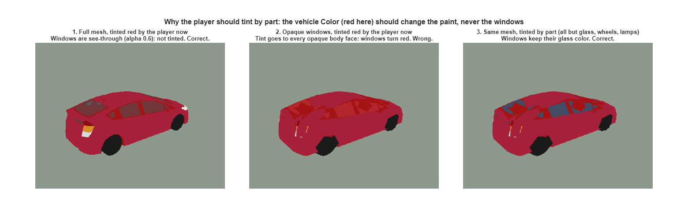

### Step 5 summary: detail levels (done 2026_11_20)

**In CarMesh3D** (release `CarMesh3D_2026_11_20`): `fcn_CarMesh3D_makeDetailLevels`, `fcn_CarMesh3D_loadDetailLevels`, the levels file `vehicleLevels_<ID>.mat` (Prius: 1026, 512, 256, 128, 64, 32, and 16 faces, then a box; Transit Connect: 1144 down to 18, then a box), and the `CameraViewAngle` check (it spans the axes' smaller side).

**In AnimateCar3D:**
- `fcn_AnimateCar3D_checkCarMesh3D`: a seventh category, `detailLevels` (the two new functions, the levels' fields and format version, their order, each level's mesh fields), and the levels file in the vehicle folder rules: 54 checks.
- `fcn_AnimateCar3D_loadMeshes`: each vehicle's full mesh and ladder (`Levels`), with `SizeDiagonal`, `BoxCenter`, and `TopScreenSize`; D and the box for simple shapes. The `LowFaces` option and the `Low` mesh are gone (CarMesh3D's levels replace `fcn_CarMesh3D_simplifyMesh` here).
- `fcn_AnimateCar3D_fillDisplayCriteria`: `TopScreenSize`, `MergeBelowSize`, `MinScreenSize`, `NominalScale`, and `MaxDistance`, in place of `NearDistance`, `MiddleDistance`, and `FarDistance`; its figure plots the tiers as sizes against distance.
- `fcn_AnimateCar3D_selectObjects`: each candidate's size on screen, tiers by size (largest first, with counts), levels with hysteresis, the `MeshSet=` option, `Pixels` in a camera structure, and `NumTooSmall` in its stats.
- `fcn_AnimateCar3D_fillDisplayList`: `Level` and `ScreenSize` for each object.
- `fcn_AnimateCar3D_playScene`: middle objects at any level (reused by mesh, tier, and level), far vehicles merged at their levels (`MergedPatch`), tint by part, and `NumMergedFaces` in its stats.
- `fcn_AnimateCar3D_changeDisplayCriteria`, the demo, and the frame-rate test use the new criteria; the demo passes the mesh set to the selector.
- Afterwards (2026_11_20): far vehicles past the middle count capped at the level made for `MergeBelowSize`; the sample car's mesh and levels cached (`SampleCacheFile`; 3.3 s to make, 0.01 s from the cache); right-hand traffic in the frame-rate test and the selector's test; the timing of new graphics; and the 1000-vehicle demonstration GIF.

**How it was checked:**
- All 17 AnimateCar3D test scripts pass; the contract check passes 54 of 54 against `CarMesh3D_2026_11_20`. New and changed tests:
  - loadMeshes: the Prius's and the Transit's ladders and D, the sample car's shorter ladder, and the boxes of simple shapes;
  - selectObjects: tiers ordered by size and within their sizes; a car pulling away stays near until its size is 10% under 105 px (and exactly at 105 px without hysteresis); sizes from a camera match the formula, and double with twice the pixels; each level is the coarsest made for its size; a car pulling away 120 m is never drawn coarser than its size needs, and hysteresis keeps a finer level at least once;
  - playScene: a middle car switching levels creates, hides, and reuses graphics; `ScreenSize` alone picks the level; far cars at three levels are merged into one patch with the right face count (a box goes with the boxes); a tinted merged car keeps its glass colors; merged faces face outward; with opaque glass, glass faces in the tinted patch keep their colors;
  - checkCarMesh3D: a newer levels format, and a missing level field, are caught.
- The demo was run step by step, and its GIFs inspected (the panning traffic, the live folder during the "all merged" edit, and the confederate scene); the picture above was checked against a marker placed in the scene (the projection agrees within a pixel).
- The frame rate was timed again (see [Frame rate](#frame-rate)).

**Problems found, and how they were handled:**
- **A small mesh's ladder starts below 105 px** (the sample car's starts at 74 px). The contract check first required the first level to be made for exactly 105 px; it now requires at most 105 px, and a middle object larger than its ladder's top is drawn with its full mesh.
- **Merged faces in dense scenes.** With 1000 vehicles close to the camera, most merged faces came from vehicles over 37 px merged only because the middle count was full. Such vehicles are now drawn at the level made for `MergeBelowSize`, which halved the merged faces (see [Frame rate](#frame-rate)); the selector's test checks it.

## TO-DO

Two lists: **To-Do** (wanted, in rough order), and **Someday** (being considered, but not needed or clearly useful yet). Each function's header also has its own TO-DO list.

### To-Do

1. **Example scenarios, simplest first.** Each is a road (above), a scene list, and motions, small enough to read in a minute; they come first in the demos.
   - *One vehicle, one maneuver (all defaults):* a lane change at constant speed on the two-lane road; following the curvy road at constant speed; following the curvy road with changing speed.
   - *Then several objects:* one car passing another; a car following another; a car stopping for a pedestrian at a crosswalk.
2. **Cross streets for the urban scene**, from the intersection prototype (done in both lane layouts); and connecting roads through junctions (OpenDRIVE `<connection>`), so vehicles can be placed on turning paths.
3. **A time option for `fcn_AnimateCar3D_playLive`** (optional input): a target frame rate, and how the data's time is tied to the clock: (a) **exactly**, the time in the data matches the clock (for example, both in seconds since the start of the run, or both clock times); or (b) **relative**, one second of clock time moves the animation one second on, from wherever it starts. Today it draws as fast as it can, with the shown time moving at `PlaybackSpeed` with the clock, which is close to (b).
**Done recently** (2026_11_20)
- A road prototype laid out like ASAM OpenDRIVE (with an intersection in two lane layouts, and pedestrians standing on sidewalks): `fcn_AnimateCar3D_fillRoad`, `fcn_AnimateCar3D_getRoadPoints`, `fcn_AnimateCar3D_plotRoad`, with presets for the two-lane, curvy, interstate, and urban scenes (see [Roads and simple scenes](#roads-and-simple-scenes-prototype)).
- Reading only the new rows of grown files in `fcn_AnimateCar3D_watchFolder`, and handling replaced and deleted files (see [Live use](#live-use-step-3)).
- A live-loop function, `fcn_AnimateCar3D_playLive`: the whole live loop in one call (or one step per call), with a CarMesh3D camera, caption, and GIF frames. See [Live use](#live-use-step-3); demo step 7 now uses it.
- Path lines (step 6): the selector lists them, the player draws them; trails and previews, color policies, your own colors and markers, screen lines or ribbons. See [Path lines](#path-lines-step-6).
- Motions as a cell array of structures in `fcn_AnimateCar3D_buildCatalog` and `fcn_AnimateCar3D_updateCatalog`, each motion with only its own fields, checked against a documented motion template (returned or printed by `fcn_AnimateCar3D_buildCatalog()` with no inputs). See [Input files](#input-files).

### Someday

- Trails that fade with age (path lines).
- **Simple road assets** to place in scenes: trees, stop signs, curbs, simple buildings, and so on. They may go into their own repository (RoadAssetPlotting, say), once the CarMesh3D work is finished, since they should follow CarMesh3D's structure and workflow (a folder per asset, a standard script, standard checks). For now, AnimateCar3D's simple shapes (boxes, bars, cylinders, pedestrians) stand in.
- **A scenario-building function:** the demos' simple motion maker (`fcn_INTERNAL_integrateMotion`: speed and curvature over time, with brake lights) could become a function for building scenarios, that is, how each object moves over time.
- **Limiting the levels used by separately drawn vehicles** (every other level, say), since a level switch costs new graphics. Measured (see [Frame rate](#frame-rate)): about 6 to 11 ms on a few steps a second, 1 to 2 ms per step on average. Reconsider if a scene has many vehicles switching levels at once (for example, a camera moving fast).

### Changes wanted in CarMesh3D

For a later CarMesh3D release. AnimateCar3D works around each one for now; the same list is in CarMesh3D's README, under "Changes wanted by AnimateCar3D".

- `fcn_CarMesh3D_plotVehicle` decides whether an axes is "new" from its visible children only, so it reformats an axes holding only `fcn_CarMesh3D_plotScene`'s hidden-handle objects, and adds lights when the scene's lights are hidden handles. (Work-around: the player draws in a scratch axes.)
- `fcn_CarMesh3D_saveGifFrame` picks a new 256-color map for each frame, so small colored details (thin lines, tinted vehicles) can turn gray. An option for a fixed color map would help. (Work-around: the main demo writes its GIF with a fixed color map.)
- The sample car as a vehicle folder in CarMesh3D's `Data`, with its finished mesh and levels file, so that `'sample'` loads like any other vehicle. (Work-around: `fcn_AnimateCar3D_loadMeshes` makes the sample car and its levels once, about 3 s, and keeps them in a cache file in MATLAB's temporary folder, `SampleCacheFile`, remade when the CarMesh3D copy changes.)
- A version function, so AnimateCar3D can check that the CarMesh3D release is new enough.
- `fcn_CarMesh3D_loadMotionCSV` to also accept a table, or numbers and column names, in place of a file name. The watcher could then keep each file's numbers, read new rows itself (about 0.01 ms instead of about 10 ms per file, the cost of `readtable`), and convert all the rows each time, so that values worked out from neighboring rows (wheel spin, steering, speed) are exact where reads meet. (Work-around: the watcher hands each chunk of new rows to the reader through a temporary file, and joins the results.)

## License

AnimateCar3D is released under the [MIT License](LICENSE), Copyright (c) 2026 Intelligent Vehicles and Systems Group (Prof. Sean Brennan). Vehicle models used through CarMesh3D keep their own licenses; see the CarMesh3D README.
