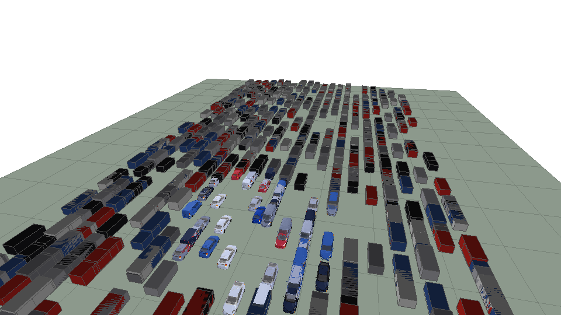
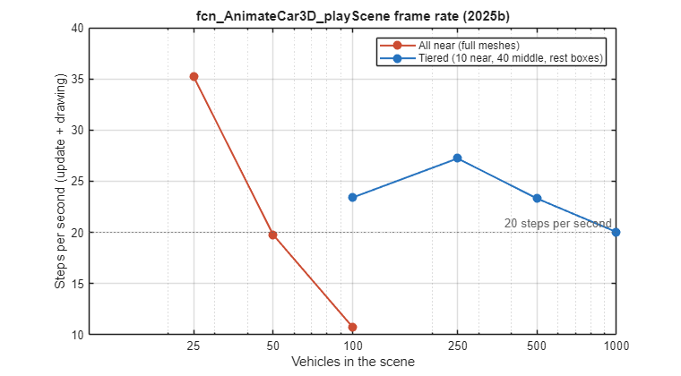

# AnimateCar3D

Fast 3D animation of scenes with many vehicles in MATLAB: decision branches, surrounding traffic, pedestrians, and moving items, with no extra toolboxes or immersive simulators (CARLA, RoadRunner, Simscape, etc.).

AnimateCar3D builds on [CarMesh3D](https://github.com/ivsg-psu/VehicleSimulations_VehiclePlotting_CarMesh3D), which makes, views, and checks the mesh of one vehicle at a time. AnimateCar3D uses CarMesh3D's vehicle meshes and plotting functions, and adds everything needed for many objects in one scene.

> **Status:** prototype (2026_11_19). Steps 0 and 1 of the [Development plan](#development-plan) are done: the scene player draws display lists with three detail tiers. The object catalog and selector (step 2) come next.

| One vehicle splitting into ten decision branches | 1000 vehicles at 20 steps per second |
|---|---|
|  |  |

## Getting started

1. Put this folder somewhere whose path has **no minus signs**.
2. Open MATLAB (written for R2025b) and run `script_demo_AnimateCar3D.m` from this folder.
3. The first run, while online, installs its dependencies (DebugTools and CarMesh3D) into the `Utilities` folder, which git ignores.

### Which copy of CarMesh3D is used

Exactly one copy of CarMesh3D is kept on the MATLAB path; the demo script removes any others. If two copies were on the path, MATLAB would silently use whichever came first, and a test could pass against the wrong version.

| Setting in `script_demo_AnimateCar3D.m` | CarMesh3D used |
|---|---|
| `flag_useWorkingCarMesh3D = 0` (default) | The newest release installed in `Utilities` (`Utilities/CarMesh3D_<date>`) |
| `flag_useWorkingCarMesh3D = 1` | A working copy, for developing both libraries together: `workingCarMesh3DFolder` if set, otherwise the folder in the environment variable `ANIMATECAR3D_CARMESH3D_PATH`, otherwise a `CarMesh3D` folder next to this one |

Setting `ANIMATECAR3D_CARMESH3D_PATH` (for example `setenv('ANIMATECAR3D_CARMESH3D_PATH','C:\...\CarMesh3D')`) turns the working copy on without editing the script. The script prints which copy it uses, and stores its folder in the environment variable `MATLABFLAG_ANIMATECAR3D_CARMESH3D_ROOT`.

### Checking CarMesh3D (the contract)

`fcn_AnimateCar3D_checkCarMesh3D` checks that the CarMesh3D copy in use still provides everything AnimateCar3D relies on. Run it after installing a new CarMesh3D release, or while changing a working copy:

```matlab
checkReport = fcn_AnimateCar3D_checkCarMesh3D(FigNum=1);   % table of results in figure 1
```

It stops with an error that lists every failed check (or only reports them with `ThrowError=false`). It checks six things:

| Category | Checks that... |
|---|---|
| `functions` | every CarMesh3D function AnimateCar3D calls exists, exactly once on the path, in the copy being checked |
| `inputs` | each function takes the same number of required inputs, and still has every Name=Value option AnimateCar3D uses |
| `motionColumns` | `fcn_CarMesh3D_saveMotionCSV` writes the 30 standard motion columns in order, and `fcn_CarMesh3D_loadMotionCSV` returns every field AnimateCar3D reads |
| `meshFields` | a mesh made by the CarMesh3D workflow, and a finished mesh from its `Data` folder, have every field AnimateCar3D reads |
| `plotting` | `fcn_CarMesh3D_plotVehicle` returns the handles AnimateCar3D moves, and moves the vehicle when called again with `PlotHandles` |
| `vehicleFolders` | vehicle folders follow the `YEAR_Make_Model_Trimline` rules and file names, and the reference vehicle list has its columns |

The full list (the "contract") is in `fcn_INTERNAL_defaultContract` inside the function. **When AnimateCar3D starts using another CarMesh3D function, option, or field, add it to the contract**, so that a later CarMesh3D change that breaks it is caught here first.

## The scene player (step 1)

Four functions draw a scene step by step. The display list is the only thing the player sees, so it does not matter whether the list came from a script (as now), the selector (step 2), or live data (step 3).

| Function | What it does |
|---|---|
| `fcn_AnimateCar3D_loadMeshes` | Loads each vehicle mesh once, at two levels of detail (the finished CarMesh3D mesh, and a low-detail copy of about 300 to 500 faces), with its size for far-tier boxes |
| `fcn_AnimateCar3D_fillDisplayList` | Builds the display list for one time step: one row per object, with its mesh, pose, detail tier, wheel and body motion, lights, color tint, and opacity. `AppendTo=` adds to a list |
| `fcn_AnimateCar3D_playScene` | Draws one display list, keeping the graphics from the step before |
| `fcn_AnimateCar3D_fillBranchMotions` | Test motions: a parent vehicle that splits into decision branches partway through |

```matlab
meshSet = fcn_AnimateCar3D_loadMeshes({'2013_Toyota_Prius_Four','2014_Ford_TransitConnect_XLTCargoLWB'});
fcn_CarMesh3D_plotScene(GroundExtent=[-50 150 -40 40], FigNum=1);     % the scene first
playerState = [];
for k = 1:K
    displayList = fcn_AnimateCar3D_fillDisplayList(Time=t(k), Instance=names, MeshID=meshIDs, ...
        Pose=poses{k}, Tier=tiers{k}, WheelSpin=spins{k});
    playerState = fcn_AnimateCar3D_playScene(displayList, meshSet, PlayerState=playerState, FigNum=1);
    drawnow;
end
fcn_AnimateCar3D_playScene([], meshSet, PlayerState=playerState, Action='clear');
```

**Detail tiers.** Each object in the display list has a tier:

| Tier | Drawn as | Moves |
|---|---|---|
| `near` | the full CarMesh3D mesh | everything `fcn_CarMesh3D_plotVehicle` does: wheels spin and steer, the body rolls, pitches, and heaves, lights switch |
| `middle` | the low-detail mesh | pose only (its transform is set directly) |
| `far` | a box of the vehicle's size | all boxes are ONE patch whose vertices are updated each step, so a thousand boxes cost about as much as one vehicle |

**Reuse.** When an object leaves the list, its graphics are hidden, not deleted, and the next object that arrives with the same mesh and tier takes them over. Hidden graphics unused for `IdleSteps` steps (default 120) are deleted. In the branching demo, the ego vehicle's graphics become one of the branches at the split.

**Style.** `Color=` tints the body (not the glass, wheels, or lamps), and `Alpha=` makes the whole vehicle see-through. Both are reapplied only when they change.

**The scene's axes is never changed.** Each new vehicle is drawn in a hidden scratch axes and then moved into the scene. (Drawing straight into the scene would let `fcn_CarMesh3D_plotVehicle` reformat the axes and add lights, because the scene's own objects, from `fcn_CarMesh3D_plotScene`, are hidden handles that `fcn_CarMesh3D_plotVehicle` does not see.) If the scene has no lights, the player adds CarMesh3D's two standard lights.

### Frame rate

`script_AnimateCar3D_frameRateTest.m` times the player with synthetic traffic on 20 lanes around an ego vehicle. A simple stand-in for the selector gives the nearest vehicles the near tier (up to 10, within 30 m), the next the middle tier (up to 40, within 70 m), and the rest within 100 m the far tier. Each step's time is split into the player's update and MATLAB's drawing (`drawnow`).



| Run | Vehicles | Near / middle / far (mean) | Update [ms] | Draw [ms] | Steps per second |
|---|---|---|---|---|---|
| all near | 25 | 26 / 0 / 0 | 9 | 19 | 35 |
| all near | 50 | 51 / 0 / 0 | 17 | 33 | 20 |
| all near | 100 | 101 / 0 / 0 | 32 | 61 | 11 |
| tiered | 100 | 11 / 40 / 49 | 11 | 31 | 23 |
| tiered | 250 | 11 / 40 / 194 | 8 | 29 | 27 |
| tiered | 500 | 11 / 40 / 440 | 9 | 34 | 23 |
| tiered | 1000 | 11 / 40 / 927 | 10 | 40 | 20 |

(MATLAB R2025b, 960 x 540 figure, on the development computer; numbers will differ on other computers. Full results: `Data/frameRate_results.csv`.)

What this shows:
- Without tiers, the time grows with every full mesh: 100 vehicles drop to about 11 steps per second.
- With tiers, the cost is set by the near and middle limits, not by the number of vehicles: 1000 vehicles still run at 20 steps per second, and the boxes add only a few milliseconds of drawing.
- Most of the time is MATLAB's drawing, not the player. The tier limits (and the figure size) are the controls for the frame rate.

## Folders

| Folder | Contents |
|---|---|
| (root) | `script_demo_AnimateCar3D.m` (the main demo), `script_AnimateCar3D_frameRateTest.m`, this README |
| `Functions` | Functions `fcn_AnimateCar3D_<name>.m`, each tested by `script_test_fcn_AnimateCar3D_<name>.m`; scripts that demonstrate the code more generally are named `script_AnimateCar3D_<name>.m` |
| `Data` | Scene lists, motion files, and static scenes for the demos; `frameRate_results.csv` |
| `Images` | Images and animations for this README |
| `Installer` | The DebugTools installer used by the demo script |
| `Utilities` | Installed dependencies (not in git) |

## The planned workflow

Every object in a scene (the ego vehicle, traffic, pedestrians, gates, buildings) goes through the same stages. All positions are in one global frame.

**At start**

1. **Inputs.**
   - Motion for each object: in memory, one CSV file per object (the CarMesh3D 30-column motion format), or files in a watched folder. Dense traffic may also use a narrow file with one row per vehicle per time step (`id, time, X, Y, yaw`, plus optional size).
   - A **scene list** with one row per object: `instance`, `role`, `meshID`, `motionFile`, `branchOf`, `branchID`, `splitTime`, `respondsTo`, `color`, `alpha`, `timeOffset`.
   - A **static scene**: fixed objects with a mesh, pose, and color.
2. **Object catalog.** Records what exists, when, and where, using a grid of cells per time window so that lookups stay fast with thousands of objects. Full motion is loaded only for objects drawn in detail. The catalog is saved as a cache and reused while the files are unchanged.

**Each time step**

3. **Display criteria.** A region (a radius around an object, a box, or the camera's view), enter and exit distances, roles to show and to always show, and distance and count limits for each detail tier. They can be changed while the animation runs.
4. **Selector.** Picks the objects to show at this time, gives each a detail tier, and builds the **display list**: the only input of the scene player.
5. **Scene player.** Draws, moves, and hides objects. It never decides what to show, and it treats static and moving objects alike.
   - Near tier: full CarMesh3D meshes, with wheels and lights.
   - Middle tier: low-face meshes.
   - Far tier: boxes, all drawn as one patch.

   Leaving objects are hidden and reused rather than deleted.
6. **Frame out.** To the screen, a GIF, or a video.
7. **Live update.** About once a second, new, grown, and deleted files in a watched folder update the catalog.

**At finish:** close output files and delete the reused graphics objects.

**Roles:** `ego`, `traffic`, `confederate` (traffic scripted to challenge the ego, which may branch), `pedestrian`, `movingItem` (gates, trains, garage doors), and `static`. A branch keeps its parent's role, names its parent in `branchOf`, and can split from it partway through the motion (`splitTime`); branches can split again. `respondsTo` links an ego branch to the confederate branch it answers.

## Development plan

0. **Repository setup** (done): template leftovers removed; one copy of CarMesh3D on the path; `fcn_AnimateCar3D_checkCarMesh3D`, which checks every CarMesh3D function, option, mesh field, motion column, and folder rule that AnimateCar3D relies on.
1. **Display list and scene player** (done), fed from memory: reuse of hidden graphics and the three detail tiers. Demo: ten ego branches splitting partway. Frame-rate test from 100 up to 1000 vehicles (20 steps per second at 1000; see [Frame rate](#frame-rate)).
2. **Scene list, object catalog, selector, and static scene.** Demos: a confederate with branches and the ego's responses; synthetic traffic passing through.
3. **Live use:** display criteria changed while running; the watched-folder source; a test helper that adds and removes files in a watched folder.
4. **Pedestrians and moving items**, as simple shapes first.

Later: a 2D (top-down) mode using the same detail tiers.

### Step 0 summary: repository setup (done 2026_11_19)

**What was done**
- **Template leftovers removed.** The repository started from the BreakDataIntoLaps template. Removed: the 10 `fcn_Laps_*` functions and their 10 test scripts, `script_demo_Laps.m`, `Documents/LapsLibrary.pptx`, the 11 Laps images, two old BreakDataIntoLaps release zips, and the PlotRoad latitude/longitude settings in the demo script. The README and `Data/README_DATA.md` were rewritten, and the license year set to 2026. The installer (`Installer`) and the dependency setup were kept unchanged.
- **One copy of CarMesh3D on the path.** `script_demo_AnimateCar3D.m` removes every CarMesh3D folder from the MATLAB path on every run, then adds back only the chosen copy, checks that MATLAB finds exactly one copy of the CarMesh3D functions, prints which one it uses, and stores its folder in `MATLABFLAG_ANIMATECAR3D_CARMESH3D_ROOT` (see [Which copy of CarMesh3D is used](#which-copy-of-carmesh3d-is-used)). Tested three ways: the installed release (a session with 14 CarMesh3D folders on the path ended with one), the working copy, and switching back.
- **Naming convention.** Functions are `fcn_AnimateCar3D_<name>.m`; scripts that test a function are `script_test_fcn_AnimateCar3D_<name>.m`; scripts that demonstrate the code more generally are `script_AnimateCar3D_<name>.m`; the main demo keeps the `script_demo_` name. (CarMesh3D was renamed to the same convention in its release `CarMesh3D_2026_11_19b`.)
- **The contract check, `fcn_AnimateCar3D_checkCarMesh3D`** (see [Checking CarMesh3D](#checking-carmesh3d-the-contract)). It checks six categories: functions (16 CarMesh3D functions, each exactly once on the path, inside the copy being checked), inputs (each function's required inputs and Name=Value options, read from its source), motion columns (the 30 standard columns written in order, and the fields read back), mesh fields (the sample car and a finished mesh from CarMesh3D's `Data`), plotting (handles, moving with `PlotHandles`, and the pose convention), and vehicle folders (names, file names, and the reference list). A failure stops with one error that lists every failed check; `ThrowError=false` only reports.

**How it was checked**
- 44 of 44 checks pass against the installed release `CarMesh3D_2026_11_19b` and against the working copy (development mode).
- `script_test_fcn_AnimateCar3D_checkCarMesh3D` also feeds the check four deliberate conflicts (a function that does not exist, an option that does not exist, the old spelling `rollRate` for `roll_rate`, a mesh field that does not exist); each is caught with a clear message.

### Step 1 summary: display list and scene player (done 2026_11_19)

**What was built** (see [The scene player](#the-scene-player-step-1))
- `fcn_AnimateCar3D_loadMeshes`: each vehicle once, as its finished mesh and a low-detail copy (the Prius: 6648 faces down to 471; the Transit Connect: 14984 down to about 300 to 500; below a few hundred faces the count stops falling because wheels and lamps are kept whole), with its size and rear overhang for far boxes.
- `fcn_AnimateCar3D_fillDisplayList`: the list of objects to draw at one step (mesh, pose, tier, wheel and body motion, lights, color, opacity), with `AppendTo=` to combine lists.
- `fcn_AnimateCar3D_playScene`: the player. Objects that leave are hidden and reused by the next arrival with the same mesh and tier; hidden graphics unused for `IdleSteps` steps are deleted. Near objects get everything `fcn_CarMesh3D_plotVehicle` does; middle objects only move (their transform is set directly, with the same pose convention, which the contract check confirms); all far boxes are one patch. Color tints only the body; opacity applies to the whole vehicle; both are reapplied only when they change.
- `fcn_AnimateCar3D_fillBranchMotions`: test motions of a parent that splits into decision branches partway through (each branch starts exactly at the parent's pose and wheel spin, and eases into its own curvature, with Ackermann steering).
- The main demo (`script_demo_AnimateCar3D.m`, step 3) and the frame-rate test (`script_AnimateCar3D_frameRateTest.m`).

**Results**
- **Ten branches** (`Images/branching_tenChoices.gif`): the Prius drives straight for 2 s, then splits into ten paths from a hard left (blue) to a hard right (red). Branches are see-through except the chosen one (solid, with a thicker path). The ego's graphics are reused as one of the branches at the split, so only ten vehicles are ever drawn (10 created, 1 reused over 121 steps).
- **Frame rate** (see [Frame rate](#frame-rate)): without tiers, 25 / 50 / 100 full meshes run at 35 / 20 / 11 steps per second. With tiers (10 near, 40 middle, the rest boxes), 100 / 250 / 500 / 1000 vehicles run at 23 / 27 / 23 / 20 steps per second. The number of vehicles barely matters with tiers: the near and middle limits set the speed. Most of each step is MATLAB's drawing (about 30 to 40 ms), not the player (about 10 ms), so the tier limits and the figure size are the controls.

**How it was checked**
- All five AnimateCar3D test scripts pass; the contract check passes 44 of 44.
- The player's test checks creation, reuse (an arriving object takes over a leaving object's graphics in the same step), hiding and deleting after `IdleSteps`, color and opacity (and restoring them), the box patch, and clearing.
- The branching GIF and the dense-traffic picture were inspected frame by frame.

**Problems found, and how they were handled**
- **The scene's axes was being reformatted.** `fcn_CarMesh3D_plotVehicle` cannot see `fcn_CarMesh3D_plotScene`'s hidden-handle objects, so it treated the scene as an empty axes: it reset the view and limits and added lights, and the first branching GIF came out blank. The player now draws each new vehicle in a hidden scratch axes and moves it into the scene, so the scene's axes is never changed; if the scene has no lights, the player adds CarMesh3D's two standard lights.
- **GIF colors.** `fcn_CarMesh3D_saveGifFrame` picks a new 256-color map for each frame, which turned the thin red paths and red-tinted branches gray. The main demo writes its GIF with one fixed color map (the first frame's 30 main colors, an even spread of 216 colors, and the branch colors).
- Both are listed under [TO-DO](#to-do) as changes wanted in a later CarMesh3D release.

## TO-DO

**Next:** step 2 (scene list, object catalog, selector, display criteria, static scene).

**Open questions**
- Path lines for branches: drawn by the player, or listed as objects in the display list? (The demo draws them itself for now.)

**Changes wanted in CarMesh3D** (for a later CarMesh3D release; AnimateCar3D works around each one for now)
- `fcn_CarMesh3D_plotVehicle` decides whether an axes is "new" from its visible children only, so it reformats an axes holding only `fcn_CarMesh3D_plotScene`'s hidden-handle objects, and adds lights when the scene's lights are hidden handles. (Work-around: the player draws in a scratch axes.)
- `fcn_CarMesh3D_saveGifFrame` picks a new 256-color map for each frame, so small colored details (thin lines, tinted vehicles) can turn gray. An option for a fixed color map would help. (Work-around: the main demo writes its GIF with a fixed color map.)
- Save the low-detail mesh with each vehicle, so `fcn_AnimateCar3D_loadMeshes` does not remake it every run.
- A version function, so AnimateCar3D can check that the CarMesh3D release is new enough.

## License

AnimateCar3D is released under the [MIT License](LICENSE), Copyright (c) 2026 Intelligent Vehicles and Systems Group (Prof. Sean Brennan). Vehicle models used through CarMesh3D keep their own licenses; see the CarMesh3D README.
